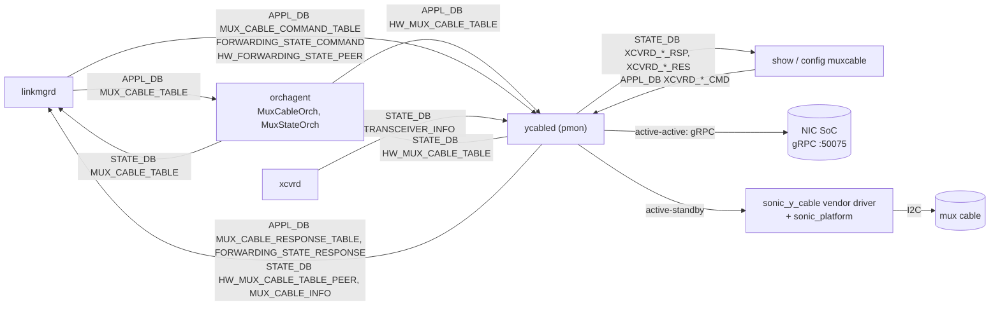

<!-- Part 1 of 5 of doc/dualtor/ycabled_to_rust_hld.md (sonic-net/SONiC#2635), lines 1-273. Split only because the file exceeds Copilot's per-file review limit; links to sections in other parts do not resolve here. -->

# ycabled in Rust

## Revision

| Rev | Date | Author | Change Description |
| :---: | :---: | :---: | --- |
| 0.1 | 11/04/26 | Longxiang Lyu | Initial version |

## Scope

This document describes a Rust implementation of ycabled, the dual ToR mux cable daemon in the pmon container, as a drop-in replacement for the Python implementation in `sonic-platform-daemons/sonic-ycabled`. It covers:

- the limitations of the Python implementation,
- the requirements for the Rust implementation,
- the current design, workflows and DB contract of Python ycabled,
- the design of Rust ycabled, its tests and its rollout.

linkmgrd, orchagent, xcvrd, the `muxcable` CLI, the SoC gRPC services and the vendor Y-cable drivers do not change.

## Content

- [ycabled in Rust](#ycabled-in-rust)
  - [Revision](#revision)
  - [Scope](#scope)
  - [Content](#content)
  - [Definitions/Abbreviations](#definitionsabbreviations)
  - [1 Background](#1-background)
    - [1.1 Role of ycabled](#11-role-of-ycabled)
    - [1.2 Limitations of Python ycabled](#12-limitations-of-python-ycabled)
      - [1.2.1 A slow SoC or cable delays every port](#121-a-slow-soc-or-cable-delays-every-port)
      - [1.2.2 Resource usage](#122-resource-usage)
      - [1.2.3 Correctness and maintainability](#123-correctness-and-maintainability)
    - [1.3 Why Rust](#13-why-rust)
  - [2 Requirements](#2-requirements)
    - [2.1 Functional](#21-functional)
    - [2.2 Compatibility](#22-compatibility)
    - [2.3 Non-functional](#23-non-functional)
    - [2.4 Non-goals](#24-non-goals)
  - [3 Current Python implementation](#3-current-python-implementation)
    - [3.1 Position in the dual ToR system](#31-position-in-the-dual-tor-system)
    - [3.2 Threads and lifecycle](#32-threads-and-lifecycle)
    - [3.3 Workflows](#33-workflows)
      - [3.3.1 Active-standby toggle](#331-active-standby-toggle)
      - [3.3.2 Active-standby probe](#332-active-standby-probe)
      - [3.3.3 Active-active toggle (self and peer)](#333-active-active-toggle-self-and-peer)
      - [3.3.4 Active-active forwarding state probe](#334-active-active-forwarding-state-probe)
      - [3.3.5 gRPC channel lifecycle](#335-grpc-channel-lifecycle)
      - [3.3.6 GracefulRestart](#336-gracefulrestart)
      - [3.3.7 Cable insertion and removal](#337-cable-insertion-and-removal)
      - [3.3.8 Telemetry](#338-telemetry)
      - [3.3.9 CLI commands](#339-cli-commands)
      - [3.3.10 Runtime knobs](#3310-runtime-knobs)
    - [3.4 External interfaces](#34-external-interfaces)
      - [3.4.1 SoC gRPC service](#341-soc-grpc-service)
      - [3.4.2 Vendor Y-cable drivers](#342-vendor-y-cable-drivers)
      - [3.4.3 Platform API](#343-platform-api)
    - [3.5 DB schema](#35-db-schema)
      - [3.5.1 CONFIG\_DB (read)](#351-config_db-read)
      - [3.5.2 APPL\_DB](#352-appl_db)
      - [3.5.3 STATE\_DB](#353-state_db)
      - [3.5.4 MUX\_CABLE\_INFO and MUX\_CABLE\_STATIC\_INFO](#354-mux_cable_info-and-mux_cable_static_info)
      - [3.5.5 CLI command tables](#355-cli-command-tables)
    - [3.6 Existing tests](#36-existing-tests)
    - [3.7 Known issues](#37-known-issues)
      - [3.7.1 Found by reading the code](#371-found-by-reading-the-code)
      - [3.7.2 Found by the black-box tests](#372-found-by-the-black-box-tests)
      - [3.7.3 State the threads share](#373-state-the-threads-share)
      - [3.7.4 Found by reviewing the unit tests](#374-found-by-reviewing-the-unit-tests)
      - [3.7.5 Cable insertion and removal after startup](#375-cable-insertion-and-removal-after-startup)
      - [3.7.6 Tests that reproduce the issues](#376-tests-that-reproduce-the-issues)
    - [3.8 Current design improvements](#38-current-design-improvements)
  - [4 Rust design](#4-rust-design)
    - [4.1 Design decisions](#41-design-decisions)
    - [4.2 Architecture](#42-architecture)
    - [4.3 Components](#43-components)
      - [4.3.1 Process, runtime and supervision](#431-process-runtime-and-supervision)
      - [4.3.2 DB access](#432-db-access)
      - [4.3.3 Router and port actors](#433-router-and-port-actors)
      - [4.3.4 SoC gRPC client](#434-soc-grpc-client)
      - [4.3.5 Port map, presence and transceiver info](#435-port-map-presence-and-transceiver-info)
      - [4.3.6 Y-cable bridge (embedded Python)](#436-y-cable-bridge-embedded-python)
      - [4.3.7 Telemetry](#437-telemetry)
      - [4.3.8 CLI commands](#438-cli-commands)
      - [4.3.9 Logging](#439-logging)
    - [4.4 Workflows](#44-workflows)
    - [4.5 Deliberate behavior differences](#45-deliberate-behavior-differences)
    - [4.6 Build, packaging and selection](#46-build-packaging-and-selection)
    - [4.7 Warm reboot, fast reboot and restart](#47-warm-reboot-fast-reboot-and-restart)
    - [4.8 Restrictions and limitations](#48-restrictions-and-limitations)
  - [5 Performance and memory](#5-performance-and-memory)
    - [5.1 Expected results](#51-expected-results)
    - [5.2 How to measure](#52-how-to-measure)
    - [5.3 Measured results](#53-measured-results)
  - [6 Testing](#6-testing)
    - [6.1 Rust unit tests](#61-rust-unit-tests)
    - [6.2 Parity tests](#62-parity-tests)
    - [6.3 Black-box component tests](#63-black-box-component-tests)
    - [6.4 System tests](#64-system-tests)
    - [6.5 Performance, fault and soak tests](#65-performance-fault-and-soak-tests)
    - [6.6 Acceptance criteria](#66-acceptance-criteria)
  - [7 Rollout and migration](#7-rollout-and-migration)
  - [8 Risks and mitigations](#8-risks-and-mitigations)
  - [9 Open questions](#9-open-questions)
  - [10 References](#10-references)

## Definitions/Abbreviations

| Term | Meaning |
| --- | --- |
| ycabled | Y-cable daemon in pmon. Older documents and log messages call it xcvrd. |
| active-standby | Dual ToR with a Y-cable whose mux connects the server to one ToR at a time. ycabled drives the mux over I2C through the cable vendor's Python driver. |
| active-active | Dual ToR where both ToR links forward. ycabled sets and queries the admin forwarding state on the server NIC's SoC over gRPC. |
| SoC | System-on-chip on the server NIC that runs the gRPC services |
| upper ToR, lower ToR | The two ToRs of a dual-ToR pair. |
| read_side | Which side of the cable this ToR is. Active-standby: (1 = upper ToR, 2 = lower ToR). Active-active: (1 = upper ToR, 0 = lower ToR). |
| PyO3 | Rust bindings to CPython, used here to embed a Python interpreter |
| tonic | Rust gRPC library on top of hyper and HTTP/2 |
| actor | A tokio task, a lightweight coroutine, that owns one mux port's state and handles that port's requests from its mailbox, one at a time. Actors are not threads: all of them share tokio's 2 worker threads ([Section 4.3.3](#433-router-and-port-actors)). |
| parity test | A test that runs the Python and the Rust daemon on the same inputs and compares their DB writes and logs |
| pmon-common | Crate shared by the Rust pmon daemons, added by [sonic-platform-daemons#915](https://github.com/sonic-net/sonic-platform-daemons/pull/915) |
| platform API facade | Generated cross-language platform API, added by [sonic-platform-common#768](https://github.com/sonic-net/sonic-platform-common/pull/768) |

## 1 Background

### 1.1 Role of ycabled

ycabled runs in the pmon container when `DEVICE_METADATA|localhost.subtype` is `DualToR`. It is the mux driver of the dual ToR system: linkmgrd decides which ToR should carry a server's traffic, orchagent programs the data plane, and ycabled applies the decision to the cable or the NIC and reports the hardware state back.

- **Active-standby:** ycabled toggles and reads the mux cable through the vendor driver, and answers linkmgrd's mux direction probes.
- **Active-active:** ycabled sets this ToR's and the peer ToR's admin forwarding state on the NIC SoC, and answers linkmgrd's forwarding state probes.
- **Both:** it publishes mux cable or SoC telemetry, handles cable insertion and removal, and executes the `show/config muxcable` hardware commands.

### 1.2 Limitations of Python ycabled

#### 1.2.1 A slow SoC or cable delays every port

Python ycabled has one thread for each kind of work, shared by all ports ([Section 3.2](#32-threads-and-lifecycle)). Whatever one port's request waits for, the requests of the other ports wait too.

- **Toggles and probes are serial.** One thread handles the toggles, the linkmgrd probes and the peer toggles of all ports, one at a time. Each active-active request is a blocking gRPC call with a 0.5 s deadline. With K unreachable SoCs ahead in the queue, a request for a healthy port waits up to K × 0.5 s.
- **Toggles go first.** Each time it wakes up, this thread handles every pending toggle before any probe, then the probes, then the peer toggles. A burst of toggles, such as many ports switching over at once, delays the probes of every port.
- **linkmgrd gives up first.** By default, linkmgrd waits 300 ms for the answer to an active-active probe: three probe intervals of 100 ms. A single hung SoC queued ahead of a healthy port's probe makes that probe time out in linkmgrd, which then retries with a backoff of up to 32 times that wait.
- **Startup is serial.** Ports are initialized one after another, and each active-active port queries its SoC, for up to 0.5 s. No request is handled until the last port is initialized.
- **Cable insertion and removal are serial.** One thread handles the cable insertions and removals of all ports. Inserting an active-standby cable loads its driver and makes about 10 cable reads, and inserting an active-active cable waits 0.5 s if the SoC does not answer. Meanwhile, the insertions and removals of other ports wait. A driver error while a cable is initialized deadlocks this thread (issue 24 in [Section 3.7](#37-known-issues)): no later insertion or removal of any port is handled, while the thread still counts as alive.
- **Telemetry is serial.** Every 60 s, one thread refreshes the telemetry of all ports in turn, with 4 RPCs per active-active port. With 32 unreachable SoCs, one pass takes 32 × 4 × 0.5 s = 64 s, longer than the period.
- **CLI commands are serial.** One thread runs the CLI commands of all ports. A slow vendor command, such as a register dump that the CLI waits up to 100 s for, delays every command after it. Firmware activation and rollback run in this thread too; only a firmware download runs in a thread of its own.
- **A port lock couples the threads.** Telemetry, insertion and the CLI lock the port around each cable call. A CLI command for a port waits for the telemetry call in progress on it, and the commands of other ports wait behind it. Toggles and probes do not take the lock (issue 26), so telemetry does not delay them.
- **One interpreter lock.** The gRPC library releases Python's interpreter lock while it waits, but the Python work around each call (parsing, DB writes, logging) of 5 or more threads still runs one at a time.
- **Failures are shared too.** An exception in one port's request ends its thread, and within 60 s the process is killed, so no port is served until ycabled has restarted (issues 3, 15, 17, 19 and 20). A deadlocked thread (issue 24) is worse: it stays alive, so nothing restarts it.

#### 1.2.2 Resource usage

| Where | Configuration | RSS | PSS | Threads | Other |
| --- | --- | --- | --- | --- | --- |
| KVM dualtor DUTs vlab-vpp-03/04 (`master.1248213`), measured 2026-11-04 | 24 active-standby ports, simulated Y-cable driver | 53-54 MB | 33-35 MB | 5 | 124 Redis TCP connections (vlab-vpp-03). CPU 0.7-0.8% of one core averaged over 2.3 days, 1.9-2.2% over a 65 s window with one telemetry pass. |
| Dev VM, Python 3.10, grpcio 1.71, measured 2026-10-27 | ycable modules loaded, 32 gRPC channels | 41 MB | - | 53 | |
| Same VM, Rust spike (tokio with 2 workers, tonic) | 32 gRPC channels | 4.5 MB | - | 3 | |
| Same VM, embedded CPython | `sonic_platform_base`, `sonic_py_common` and `sonic_y_cable` drivers imported | 26.5 MB | - | - | A bare interpreter is 8.5 MB. |

- grpcio starts a connectivity-polling thread for every channel ycabled subscribes to, so Python's thread count grows with the number of active-active ports.
- Every table-helper class opens its own DB connectors, and every `SubscriberStateTable` opens another connection. ycabled held 124 Redis connections on a 24-port DUT.
- The KVM numbers do not include a vendor platform plugin. On hardware, ycabled also loads `sonic_platform`.
- Active-active numbers on a DUT are still to be measured on the physical testbeds.

#### 1.2.3 Correctness and maintainability

- About 5.2K lines in three modules. State such as driver instances, gRPC stubs, channels and counters lives in module globals shared by 5 or more threads, and only the vendor driver calls are locked (per port).
- Mistakes such as undefined names or wrong fields only show up at run time. [Section 3.7](#37-known-issues) lists 32 issues: 14 found by reading the code, 11 by the black-box tests ([Section 6.3](#63-black-box-component-tests)), and 7 by reviews of the state the threads share and of the unit tests. Among them: a shutdown that never completes, a startup deadlock after one driver error, and a syslog identity that changes with import order.
- The 306 unit tests (81% line coverage) patch Python internals, so they cannot check another implementation. 27 more never run because of duplicate names.

### 1.3 Why Rust

- **Memory saving, the top consideration.** ycabled runs on every dual ToR device. Rust runs no interpreter where none is needed: the active-active path is native code only, and active-standby ports embed one only for the vendor drivers.
- **Isolation with few threads.** Async I/O (tokio) gives every port its own sequential worker while the process keeps a small, fixed number of threads.
- **Compile-time checks.** Types, ownership and `Send`/`Sync` rule out the classes of problems listed in [Section 3.7](#37-known-issues).

## 2 Requirements

### 2.1 Functional

| ID | Requirement |
| --- | --- |
| F1 | Implement every function of Python ycabled described in [Section 3](#3-current-python-implementation): <ul><li>active-standby: toggle and probe</li><li>active-active: self and peer toggle, forwarding state probe, connectivity reporting and the GracefulRestart stream</li><li>cable insertion and removal</li><li>`MUX_CABLE_INFO` and `MUX_CABLE_STATIC_INFO` telemetry and `MUX_METRICS_TABLE` timestamps</li><li>all `XCVRD_*` CLI commands and the `XCVRD_LOG` knobs</li><li>multi-ASIC namespaces (Python ycabled cannot start on a multi-ASIC platform, issue 23 in [Section 3.7](#37-known-issues)), and the KVM (VS) platform including the simulated Y-cable driver</li></ul> |
| F2 | Load vendor Y-cable drivers exactly as Python does ([Section 3.4.2](#342-vendor-y-cable-drivers)): selection through `y_cable_vendor_mapping`, the `get_vendor()` check and the `/etc/sonic/mux_simulator.json` override. |
| F3 | Talk to the SoC with the same proto, TCP port 50075, TLS settings, keepalive options and deadlines ([Section 3.4.1](#341-soc-grpc-service)). |

### 2.2 Compatibility

These are contracts with other components and with sonic-mgmt. They must not change.

| ID | Contract | Defined by |
| --- | --- | --- |
| C1 | DB keys, fields, value domains and formats in [Section 3.5](#35-db-schema), including the timestamp format `%Y-%b-%d %H:%M:%S.%f` (UTC) and Python's `str()` form of driver values (a `None` is written as `None`) | this document |
| C2 | When ycabled writes `FORWARDING_STATE_RESPONSE.response = failure`. linkmgrd treats it as a gRPC connection failure for active-active ports. | linkmgrd `MuxPort::handleProbeMuxState` |
| C3 | The CLI request/response protocol, and responses within the CLI timeouts | sonic-utilities `show/config muxcable` |
| C4 | supervisord program name `ycabled`, the `skip_ycabled` and `delay_ycabled` options, and restart with `supervisorctl restart ycabled` | `docker-pmon.supervisord.conf.j2`, `test_switchover_faulty_ycable.py` |
| C5 | Syslog identity `ycable`. Messages matched by sonic-mgmt keep their text. Nothing is logged at ERR that Python logs at a lower level. | The `pmon#ycable` rules in `loganalyzer_common_ignore.txt` |
| C6 | A vendor driver file replaced on the DUT is picked up when ycabled restarts | `test_switchover_faulty_ycable.py` |
| C7 | DB tables written by ycabled are not deleted when it stops, so orchagent, linkmgrd and `show muxcable` keep the last state across a restart. This is Python's effective behavior, and a deliberate change from what Python intends: its `deinit()` would delete the `HW_MUX_CABLE_TABLE`, `MUX_CABLE_STATIC_INFO` and `MUX_CABLE_INFO` rows and the `GRPCCLIENT` keys it copied, but never runs (issue 1 in [Section 3.7](#37-known-issues)). | The DB contract allows no delete besides the CLI's command keys; `test_stop_keeps_tables` |

### 2.3 Non-functional

The targets are proposals, to be confirmed against baselines measured on the physical testbeds.

| ID | Requirement | Proposed target |
| --- | --- | --- |
| N1 | A slow or unreachable SoC, or a slow cable, does not delay requests for other ports | Toggle and probe response for healthy ports p99 < 100 ms with 4 of 32 SoCs not responding (Python: up to 2 s) |
| N2 | Requests for one port are processed in the order their notifications arrive. As with `SubscriberStateTable`, a request is a row read when its notification is handled, so a row written again before then is handled with its latest value. | |
| N3 | Ports are initialized in parallel | All active-active ports initialized within 1 s with every SoC unreachable (Python: ports × 0.5 s) |
| N4 | Memory | Device with only active-active ports: RSS ≤ 15 MB. Device with active-standby ports: RSS ≤ 70% of Python's on the same device. |
| N5 | Threads and DB connections bounded, independent of the port count | ≤ 16 threads besides those of driver calls in flight (at most 2 per active-standby port), ≤ 48 Redis connections per namespace |
| N6 | CPU | Idle CPU no higher than Python's |
| N7 | Every external call (gRPC, vendor driver, Redis) has a deadline, or runs where it can only block its own port | |
| N8 | If an internal task fails, the process exits non-zero and supervisord restarts it, as with Python | Exit immediately (Python: within 60 s) |
| N9 | SIGTERM ends the process | ≤ 2 s (Python: never ends by itself) |
| N10 | Selected per platform ([Section 4.6](#46-build-packaging-and-selection)). Both implementations installed side by side. Switching needs no rebuild. | |
| N11 | Tests | Rust unit test line coverage ≥ 80%. Parity and black-box tests run in CI. |
| N12 | ycabled's test coverage improves, with tests that check its behavior only through its interfaces (redis, syslog, the SoC's gRPC services and the vendor driver API), so the same tests run against Python and Rust ycabled ([Section 6.3](#63-black-box-component-tests)) | Every DB contract entry and every workflow in [Section 3.3](#33-workflows), failure paths included, is exercised, and every known issue in [Section 3.7](#37-known-issues) that a test can observe has a test. With the unit tests, ≥ 95% of Python ycabled's statements are covered (unit tests alone: 81%). |

### 2.4 Non-goals

- Changing the DB schema, the CLI, linkmgrd, orchagent or the SoC proto.
- Porting the vendor Y-cable drivers (`sonic_y_cable`) to Rust. They stay Python.
- Warm-restart state. Python ycabled has none.
- Changing linkmgrd's or orchagent's timers or behavior.

## 3 Current Python implementation

### 3.1 Position in the dual ToR system

A switchover runs through every component in the loop:

1. linkmgrd writes the target state to APPL_DB `MUX_CABLE_TABLE`.
2. orchagent's `MuxCableOrch` reprograms neighbors and routes, then writes APPL_DB `HW_MUX_CABLE_TABLE`.
3. ycabled applies the state to the mux cable or the SoC and writes STATE_DB `HW_MUX_CABLE_TABLE`.
4. orchagent's `MuxStateOrch` reconciles it and writes STATE_DB `MUX_CABLE_TABLE`, which linkmgrd reads.

### 3.2 Threads and lifecycle

| Thread | Started | Waits on | Work |
| --- | --- | --- | --- |
| main (`DaemonYcable`) | always | stop event, 60 s timeout | Initialization (below). Every 60 s, checks that the threads are alive; if one has ended it SIGKILLs its own process. |
| `YcableInfoUpdateTask` | always | 60 s timer | `MUX_CABLE_INFO` of every mux port, one after another, unless telemetry is disabled |
| `YcableStateUpdateTask` | always | STATE_DB `TRANSCEIVER_INFO` (select, 100 ms timeout) | Cable insertion and removal |
| `YCableTableUpdateTask` | if any mux cable is found at startup | APPL_DB `HW_MUX_CABLE_TABLE`, `MUX_CABLE_COMMAND_TABLE`, `FORWARDING_STATE_COMMAND`, `HW_FORWARDING_STATE_PEER` (select, 1 s) | Toggles, probes and peer toggles, one at a time |
| `YCableCliUpdateTask` | if any mux cable is found at startup | CONFIG_DB `XCVRD_LOG` and 14 APPL_DB `XCVRD_*_CMD` tables (select, 1 s) | CLI commands, one at a time. A firmware download runs in a new thread per port. |
| `YCableAsyncNotificationTask` | if any port is active-active | asyncio event loop | One GracefulRestart stream per port with a SoC IP |
| grpcio internal threads | one or more per channel | | Connectivity polling, and the `wait_for_state_change` callback |
