<!-- Part 2 of 5 of doc/dualtor/ycabled_to_rust_hld.md (sonic-net/SONiC#2635), lines 274-628. Split only because the file exceeds Copilot's per-file review limit; links to sections in other parts do not resolve here. -->

### 3.3 Workflows

#### 3.3.1 Active-standby toggle

1. orchagent writes APPL_DB `HW_MUX_CABLE_TABLE:<port>` `state` = `active` or `standby`.
2. ycabled reads `read_side` from STATE_DB `HW_MUX_CABLE_TABLE` and calls `toggle_mux_to_tor_a()` (upper ToR) or `toggle_mux_to_tor_b()` (lower ToR): active with read_side 1 means the upper ToR, active with read_side 2 means the lower ToR, and standby means the other one. If read_side is not 1 or 2, it calls `get_read_side()` first.
3. It writes STATE_DB `MUX_METRICS_TABLE` `xcvrd_switch_<state>_start` and `_end`, then STATE_DB `HW_MUX_CABLE_TABLE` `state`, `read_side` and `active_side`. The mux direction is not read back after the toggle.
   - **Success:** `state` is the requested state, `active_side` the side the mux was toggled to (1 for the upper ToR, 2 for the lower ToR), and `read_side` is unchanged.
   - **Failure:** the driver returns anything but `True`, raises, or the port has no driver. `state` is `unknown`, in the metrics field names too (`xcvrd_switch_unknown_start` and `_end`), and `active_side` is -1. `read_side` keeps its value, unless the cable is absent or its read side had to be read again and could not be; then it is -1 too. Nothing is retried.

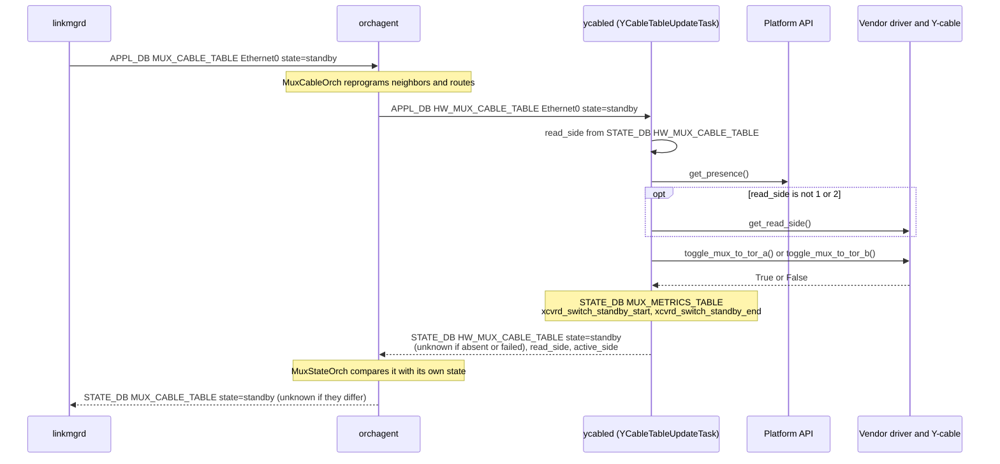

#### 3.3.2 Active-standby probe

linkmgrd writes APPL_DB `MUX_CABLE_COMMAND_TABLE:<port>` `command=probe`. ycabled reads `read_side` from STATE_DB `HW_MUX_CABLE_TABLE`, calls `get_mux_direction()`, and writes APPL_DB `MUX_CABLE_RESPONSE_TABLE` `response`:

- **Success:** the direction is 1 or 2. `response` is `active` if it equals read_side, `standby` if not.
- **Failure:** the cable is absent, the port has no driver, or `get_mux_direction()` raises or returns anything but 1 or 2. `response` is `unknown`. Nothing is retried.
- **Read side not 1 or 2:** 0 (the NIC side) or -1 (not readable) never equals the direction, so `response` is `standby` (issue 31 in [Section 3.7](#37-known-issues)).
- **Ignored:** a command other than `probe`, or a port without a STATE_DB `HW_MUX_CABLE_TABLE` entry. Nothing is written.

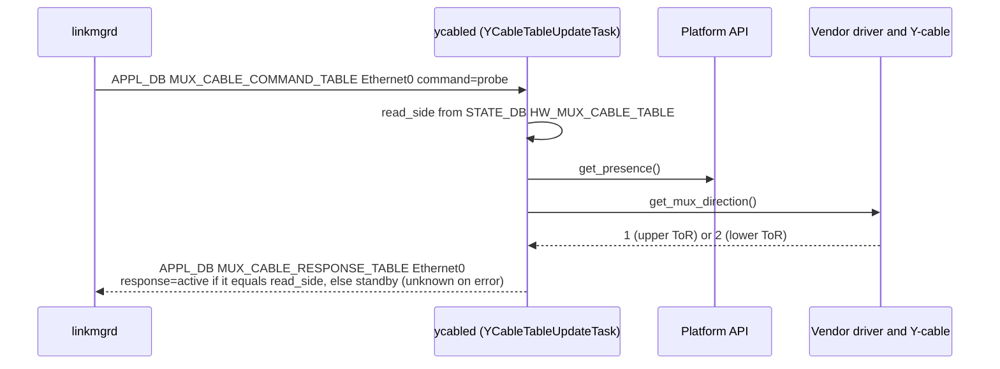

#### 3.3.3 Active-active toggle (self and peer)

- **Self:** APPL_DB `HW_MUX_CABLE_TABLE:<port>` `state` → `SetAdminForwardingPortState(portid=[read_side], state=[1 or 0])`, with read_side from STATE_DB `HW_MUX_CABLE_TABLE`.
- **Peer:** APPL_DB `HW_FORWARDING_STATE_PEER:<port>` `state` → the same with `portid=[1 - read_side]`, with read_side from STATE_DB `HW_MUX_CABLE_TABLE_PEER`.
- **Written:** STATE_DB `MUX_METRICS_TABLE` `xcvrd_switch_self_<state>_start` and `_end` (`peer` for a peer toggle), then `state`, `read_side` and `active_side` in the STATE_DB table read_side came from. `read_side` is written back unchanged. Unlike active-standby, `active_side` is the state the SoC reports, not a side number.
- **Success:** the reply names the requested port id. `state` is the requested state, and `active_side` the reported one, `active` or `standby`. If the SoC reports the opposite of the request, `state` is still the requested one.
- **Failure:** the RPC fails or reaches its 0.5 s deadline, or the reply is empty or names another port id. `state` and `active_side` are `unknown`, in the metrics field names too (`xcvrd_switch_self_unknown_start` and `_end`). Nothing is retried.
- **No channel:** ycabled tries once to set it up again. If that fails, it writes the same as for a failed RPC, without calling the SoC.
- **Read side -1** (no usable Loopback3): the request still goes to the SoC, with port id -1, or 2 for the peer (issue 30).
- **Ignored:** a state other than `active` or `standby`, or a port without an entry in the table. Nothing is written.

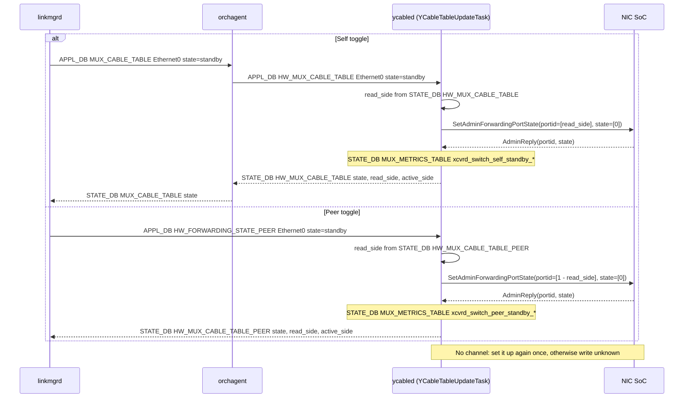

Because one thread handles every port, a SoC that does not answer delays the toggles of the other ports:

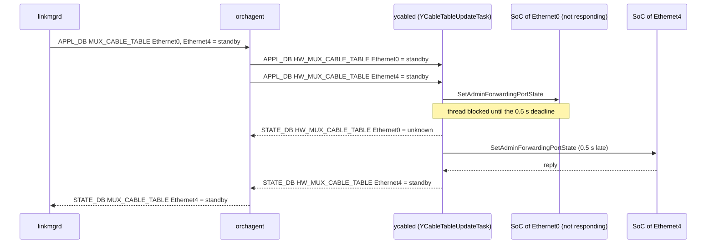

#### 3.3.4 Active-active forwarding state probe

linkmgrd writes APPL_DB `FORWARDING_STATE_COMMAND:<port>` `command=probe`. ycabled reads `read_side` from STATE_DB `HW_MUX_CABLE_TABLE`, calls `QueryAdminForwardingPortState(portid=[0, 1], state=[0, 0])`, and writes APPL_DB `FORWARDING_STATE_RESPONSE` `response` for this ToR and `response_peer` for the peer:

- **Success:** the reply has two port ids and two states. `response` is `active` if `state[read_side]` is true and `standby` if it is false, and `response_peer` likewise from `state[1 - read_side]`. The port ids in the reply are not checked.
- **Failure:** the RPC fails or reaches its 0.5 s deadline, or the reply does not have two port ids and two states. Both are `unknown`. Nothing is retried.
- **No channel:** ycabled tries once to set it up again. If that fails, both are `unknown`, without calling the SoC.
- **Read side -1** (no usable Loopback3): the RPC is still made, and both are `unknown`.
- **Probe counters:** every RPC, successful or not, increments the counters that telemetry publishes in `MUX_CABLE_INFO`.
- **Ignored:** a command other than `probe`, or a port without a STATE_DB `HW_MUX_CABLE_TABLE` entry. Nothing is written.

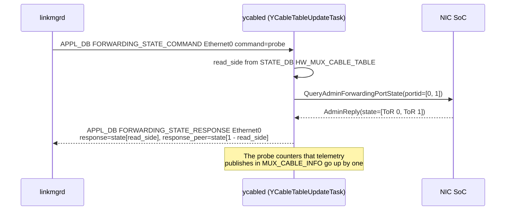

#### 3.3.5 gRPC channel lifecycle

- **Target:** `soc_ipv4` from `MUX_CABLE`, or `soc_ipv6` if there is no IPv4 address, without the prefix length. IPv6 is written as `[addr]:50075`.
- **Creation:** channels are created at startup, when a cable is inserted, and by a toggle or probe of a port without one, which tries once. They are not recreated when CONFIG_DB changes.
- **Connectivity:** a callback records every state change (`READY`, `CONNECTING`, `IDLE`, `TRANSIENT_FAILURE`, `SHUTDOWN`) for `MUX_CABLE_INFO.grpc_connection_status`. On `TRANSIENT_FAILURE` or `IDLE` it also writes APPL_DB `FORWARDING_STATE_RESPONSE` `response=failure`, which linkmgrd handles as a connection failure.

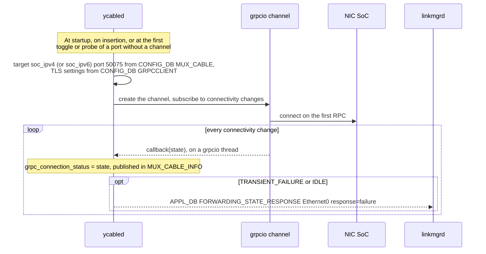

#### 3.3.6 GracefulRestart

For each `MUX_CABLE` port with a SoC address (active-standby ports too, once any port is active-active), ycabled calls `NotifyGracefulRestartStart(tor)`, with `tor` = `UPPER_TOR` if read_side is 0 and `LOWER_TOR` otherwise, and reads the stream. When the stream ends, it waits `period` seconds from the last response (20 s if there was none or the call failed) and subscribes again. Responses are only logged; nothing is written to the DB.

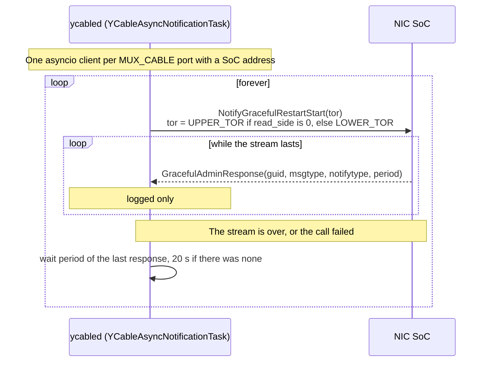

#### 3.3.7 Cable insertion and removal

ycabled subscribes to STATE_DB `TRANSCEIVER_INFO`, written by xcvrd:

- **SET (inserted):** ignored if the port's driver is already initialized ([#882](https://github.com/sonic-net/sonic-platform-daemons/pull/882)); otherwise the port is initialized as at startup, with its cable type read again from CONFIG_DB `MUX_CABLE`.
- **DEL (removed):** STATE_DB `HW_MUX_CABLE_TABLE` gets `state=unknown` and `active_side=-1`, and the driver instance is dropped. `MUX_CABLE_INFO` and `MUX_CABLE_STATIC_INFO` are kept.

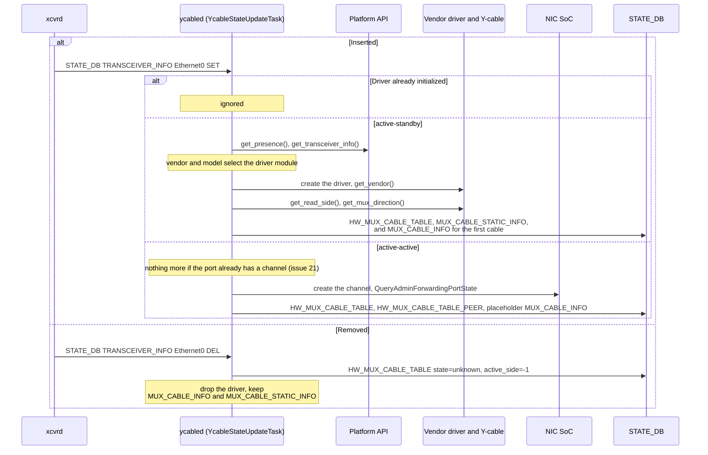

#### 3.3.8 Telemetry

Every 60 s after the previous pass ends, for every port whose `MUX_CABLE.state` is valid, unless `XCVRD_LOG|Y_CABLE.disable_telemetry` is `True`:

- **active-standby:** 27 `MUX_CABLE_INFO` fields from the vendor driver (mux direction, switch counts, eye heights, temperatures, voltages, link status, firmware versions). If the port has no driver, nothing is written, and ERR "Error: Could not get port instance for muxcable info for Y cable port \<port\>" is logged. While a firmware download runs on the port, the firmware versions are copied from what `MUX_CABLE_INFO` already holds instead of being read from the cable; the other fields are still read from the cable.
- **active-active:** 4 RPCs (`QueryLinkState`, `QueryOperationPortState`, `QueryAdminForwardingPortState`, `QueryServerVersion`) fill 15 `MUX_CABLE_INFO` fields. The probe counters written are the counts before this pass, `unknown` until the first query of that kind.
- **Cable absent (either type):** the 27 active-standby fields are written with placeholder values (`unknown` or `N/A`).

`MUX_CABLE_STATIC_INFO` (read_side and 30 cursor values, active-standby only) is written at initialization only.

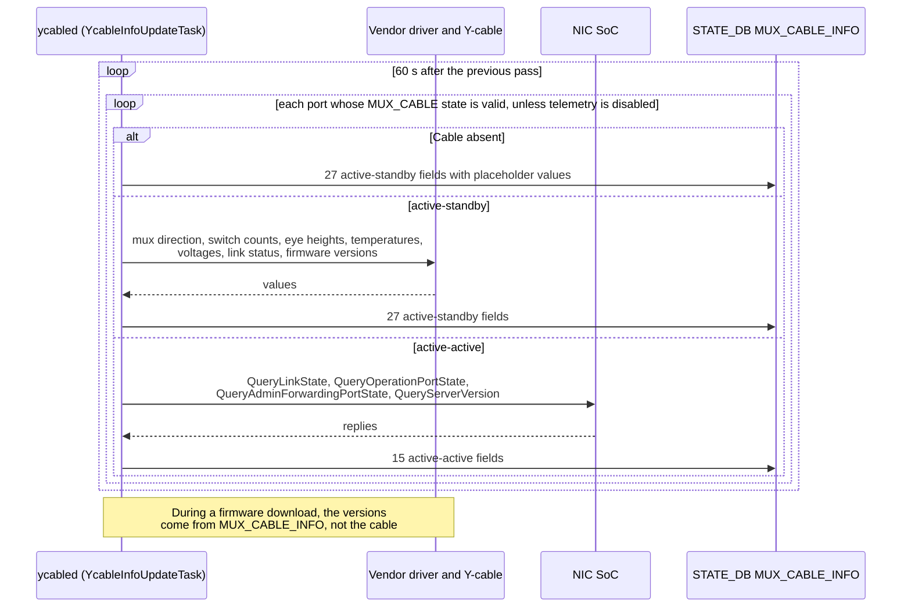

#### 3.3.9 CLI commands

1. The CLI deletes old entries in the command, argument, response and result tables of the command.
2. For some commands, it writes the arguments to APPL_DB `<CMD>_ARG:<port>`.
3. It writes APPL_DB `<CMD>:<port>` with `<command field>=<value>`.
4. It waits on STATE_DB `<RSP>|<port>` for the response field, with a timeout of 1 s to 1000 s depending on the command.
5. ycabled calls the vendor driver. For an active-active `hwmode muxdirection` it answers the state it last published in STATE_DB `HW_MUX_CABLE_TABLE`, and asks the SoC only if there is none. It writes any result rows to STATE_DB `<RES>|<port>`, then the response field, then deletes the command key.

**Firmware versions during a download:** the vendor driver sets its `download_firmware_status` attribute to in progress when `download_firmware()` starts, and to finished or failed when it ends; ycabled only reads it. While it is in progress, `show muxcable firmware version` and telemetry ([Section 3.3.8](#338-telemetry)) do not call `get_firmware_version()`. They answer the nine `version_<nic|self|peer>_<active|inactive|next>` fields from STATE_DB `MUX_CABLE_INFO`: `N/A` if the port has no entry, `None` for a missing field. The values are therefore those of the last telemetry pass before the download. The command still reads the read side from the cable, to tell self from peer. Once the download has finished or failed, versions are read from the cable again; a failed download is also logged at ERR.

The command tables are listed in [Section 3.5.5](#355-cli-command-tables).

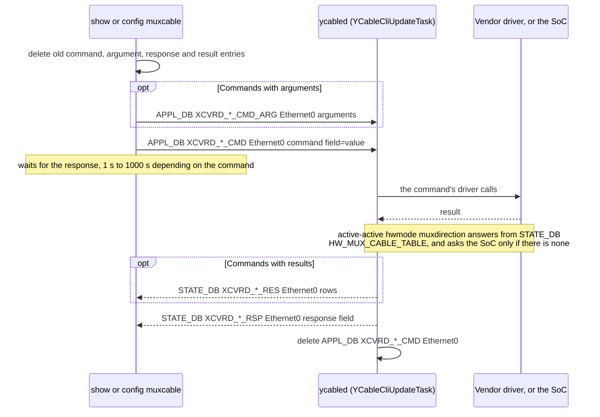

#### 3.3.10 Runtime knobs

CONFIG_DB `XCVRD_LOG|Y_CABLE`:

- `log_verbosity` = `debug` or `notice` sets the log level.
- `disable_telemetry` = `True` or `False` stops or resumes telemetry. It is written by `config muxcable telemetry`.

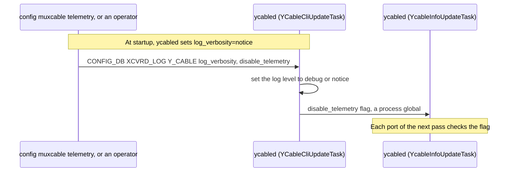

### 3.4 External interfaces

#### 3.4.1 SoC gRPC service

| RPC | Request | Used for | Deadline |
| --- | --- | --- | --- |
| `DualToRActive.QueryAdminForwardingPortState` | `AdminRequest{portid: [0, 1], state: [0, 0]}` | Initial state, forwarding state probe, telemetry, `show muxcable hwmode muxdirection` | 0.5 s |
| `DualToRActive.SetAdminForwardingPortState` | `AdminRequest{portid: [side], state: [1 or 0]}` | Self and peer toggles | 0.5 s |
| `DualToRActive.QueryOperationPortState` | `OperationRequest{portid: [0, 1]}` | Telemetry | 0.5 s |
| `DualToRActive.QueryLinkState` | `LinkStateRequest{portid: [0, 1]}` | Telemetry | 0.5 s |
| `DualToRActive.QueryServerVersion` | `ServerVersionRequest{version: "1.0"}` | Telemetry | 0.5 s |
| `GracefulRestart.NotifyGracefulRestartStart` | `GracefulAdminRequest{tor}`, server stream of `GracefulAdminResponse` | Logging only | none |

- **Channel options:** keepalive every 4 s, keepalive timeout 8 s, keepalive without calls, unlimited pings without data.
- **TLS:** `GRPCCLIENT|config` `type=secure` uses the files in `GRPCCLIENT|certs`. `auth_level=server` verifies the server with `ca_crt`; `auth_level=mutual` also presents `client_crt` and `client_key`. `grpc_ssl_credential` overrides the TLS target name. With `type=insecure`, or no `config` key, the channel is plaintext.
- **read_side:** the reply index of this ToR comes from hard-coded Loopback3 addresses (`process_loopback_interface_and_get_read_side`):

| CONFIG_DB `LOOPBACK_INTERFACE` key | read_side | ToR | This ToR in replies | Peer in replies | GracefulRestart `tor` |
| --- | :---: | --- | :---: | :---: | --- |
| `Loopback3\|10.212.64.2/32` or `Loopback3\|10.1.0.39/32` | 0 | lower | `state[0]` | `state[1]` | `UPPER_TOR` |
| `Loopback3\|10.212.64.1/32` or `Loopback3\|10.1.0.38/32` | 1 | upper | `state[1]` | `state[0]` | `LOWER_TOR` |
| anything else | -1 | unknown | `unknown` | `unknown` | `LOWER_TOR` |

On an active-standby cable, the upper ToR reads read_side 1 and the lower ToR 2. sonic-mgmt makes the first ToR of the testbed file the upper one and gives it the first Loopback3 address, 10.1.0.38 (`dual_tor_facts.py`), and its NIC simulator answers for the upper ToR at port id 1. Lab testbeds agree: the 10.1.0.38 ToR reads 1 from active-standby cables and gets read_side 1 with active-active ones. Python's GracefulRestart `tor` is the other way round: the lower ToR sends `UPPER_TOR` ([Section 9](#9-open-questions), question 9).

#### 3.4.2 Vendor Y-cable drivers

- **Where they live:** sonic-platform-common `sonic_y_cable`. `YCableBase` defines 60 methods. The vendor drivers are Credo (`credo.y_cable_credo`), Molex cables with `broadcom.y_cable_broadcom`, and the simulated driver for test (`microsoft.y_cable_simulated`, which talks HTTP to the mux simulator).
- **Hardware access:** drivers do their own I/O through `sonic_platform`: `Platform().get_chassis().get_sfp(port).read_eeprom()` and `write_eeprom()`.
- **Selection:**
  1. Read manufacturer and model from the platform API, then lower-case and strip them.
  2. If `/etc/sonic/mux_simulator.json` exists, use `microsoft` and `simulated` instead.
  3. Look up `y_cable_vendor_mapping.mapping[vendor][model]`, import `sonic_y_cable.<module>` and create `YCable(physical_port, logger)`.
  4. The driver's `get_vendor()` must match; otherwise the port is reported `unknown`.
- **Methods used by ycabled:**
  - toggles: `toggle_mux_to_tor_a`, `toggle_mux_to_tor_b`
  - state: `get_read_side`, `get_mux_direction`, `get_active_linked_tor_side`, `is_link_active`, `get_switch_count_total`
  - signal quality: eye, BER, FEC and PCS
  - temperatures and voltages
  - firmware: version, download, activate, rollback, download status
  - switching mode, PRBS, loopback, ANLT, FEC mode, event log
  - health check, reset cause, operation time, queue info, debug dump

#### 3.4.3 Platform API

- **Presence:** `chassis.get_sfp(i).get_presence()`, falling back to sfputil. Always true on VS.
- **Transceiver info:** `chassis.get_sfp(i).get_transceiver_info()`, falling back to sfputil. Empty on VS.
- **Port mapping:** `SfpUtilHelper` reads CONFIG_DB `PORT` (`index`) through sonic-config-engine's `get_port_config`, and `port_config.ini` only if `PORT` is empty.
