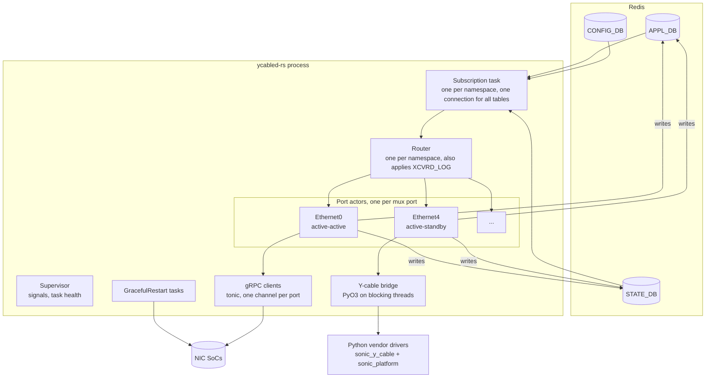

<!-- Part 3 of 5 of doc/dualtor/ycabled_to_rust_hld.md (sonic-net/SONiC#2635), lines 629-892. Split only because the file exceeds Copilot's per-file review limit; links to sections in other parts do not resolve here. -->

### 3.5 DB schema

#### 3.5.1 CONFIG_DB (read)

| Table | Key | Field | Description |
| --- | --- | --- | --- |
| MUX_CABLE | \<PORT\> | state | `auto`, `manual`, `detach`, `active` or `standby`. The port is handled only if `state` is one of these. |
| | | cable_type | `active-standby` (default) or `active-active` |
| | | soc_ipv4, soc_ipv6 | SoC address with prefix length. IPv4 is preferred. |
| GRPCCLIENT | config | type | `secure` or `insecure` |
| | | auth_level | `server` or `mutual` in ycabled; the YANG model allows `server` or `client` (issue 7 in [Section 3.7](#37-known-issues)) |
| GRPCCLIENT | certs | ca_crt, client_crt, client_key | Certificate and key file paths |
| | | grpc_ssl_credential | TLS target name override |
| LOOPBACK_INTERFACE | Loopback3\|\<ip\>/\<len\> | | Gives read_side ([Section 3.4.1](#341-soc-grpc-service)) |
| DEVICE_METADATA | localhost | platform | Detects VS |
| PORT | \<PORT\> | index | Port map ([Section 3.4.3](#343-platform-api)) |
| CONFIG_DB_INITIALIZED | (plain key) | | Waited for at startup, through `sonic_py_common` |
| XCVRD_LOG | Y_CABLE | log_verbosity, disable_telemetry | Runtime knobs, subscribed ([Section 3.3.10](#3310-runtime-knobs)) |

ycabled also writes to CONFIG_DB. At every start it sets `XCVRD_LOG|Y_CABLE` `log_verbosity=notice`, and copies the `GRPCCLIENT` fields from `/etc/sonic/grpc_secrets.json` that CONFIG_DB lacks.

#### 3.5.2 APPL_DB

| Table | Key | Field | Direction | Description |
| --- | --- | --- | --- | --- |
| HW_MUX_CABLE_TABLE | \<PORT\> | state | in, from orchagent | `active` or `standby`: set this ToR's side |
| HW_FORWARDING_STATE_PEER | \<PORT\> | state | in, from linkmgrd | `active` or `standby`: set the peer's side (active-active) |
| MUX_CABLE_COMMAND_TABLE | \<PORT\> | command | in, from linkmgrd | `probe` (active-standby) |
| FORWARDING_STATE_COMMAND | \<PORT\> | command | in, from linkmgrd | `probe` (active-active); ycabled ignores other values |
| MUX_CABLE_RESPONSE_TABLE | \<PORT\> | response | out, to linkmgrd | `active`, `standby` or `unknown` |
| FORWARDING_STATE_RESPONSE | \<PORT\> | response, response_peer | out, to linkmgrd | `active`, `standby` or `unknown`. `response` is `failure` when the channel goes to `TRANSIENT_FAILURE` or `IDLE`. |
| XCVRD_\*_CMD, XCVRD_\*_CMD_ARG | \<PORT\> | | in, from the CLI | [Section 3.5.5](#355-cli-command-tables) |

#### 3.5.3 STATE_DB

| Table | Key | Field | Direction | Description |
| --- | --- | --- | --- | --- |
| TRANSCEIVER_INFO | \<PORT\> | | in, from xcvrd | SET means inserted, DEL means removed |
| HW_MUX_CABLE_TABLE | \<PORT\> | state | out, to orchagent | `active`, `standby` or `unknown` |
| | | read_side | | active-standby: `1`, `2` or `-1` (`0` if the cable reports the NIC side, then `state` is `standby`). active-active: `0`, `1` or `-1` |
| | | active_side | | active-standby: `0` (no ToR), `1`, `2` or `-1`. active-active: `active`, `standby` or `unknown` |
| HW_MUX_CABLE_TABLE_PEER | \<PORT\> | state, read_side, active_side | out, to linkmgrd | The peer's side, active-active only |
| MUX_CABLE_INFO | \<PORT\> | [Section 3.5.4](#354-mux_cable_info-and-mux_cable_static_info) | out, to linkmgrd, CLI and telemetry | Cable or SoC telemetry |
| MUX_CABLE_STATIC_INFO | \<PORT\> | [Section 3.5.4](#354-mux_cable_info-and-mux_cable_static_info) | out, to the CLI | active-standby only |
| MUX_METRICS_TABLE | \<PORT\> | xcvrd_switch_\<state\>_start, _end | out, to the CLI | active-standby toggle timestamps |
| | | xcvrd_switch_\<self or peer\>_\<state\>_start, _end | | active-active toggle timestamps |
| XCVRD_\*_RSP, XCVRD_\*_RES | \<PORT\> | | out, to the CLI | [Section 3.5.5](#355-cli-command-tables) |

Timestamps are UTC in the format `%Y-%b-%d %H:%M:%S.%f`, e.g. `2026-Nov-04 10:43:04.123456`.

#### 3.5.4 MUX_CABLE_INFO and MUX_CABLE_STATIC_INFO

| Table | Cable type | Fields |
| --- | --- | --- |
| MUX_CABLE_INFO | active-standby (27) | tor_active, time_post, mux_direction, manual_switch_count, auto_switch_count, link_status_self, link_status_peer, link_status_nic, {self, peer, nic}\_eye_height_lane{1, 2}, internal_temperature, internal_voltage, nic_temperature, nic_voltage, version\_{self, peer, nic}\_{active, inactive, next} |
| MUX_CABLE_INFO | active-active (15) | time_post, self_link_state, peer_link_state, self_oper_state, peer_oper_state, self_mux_direction, peer_mux_direction, server_version, grpc_connection_status, mux_direction_probe_count, peer_mux_direction_probe_count, link_state_probe_count, peer_link_state_probe_count, operation_state_probe_count, peer_operation_state_probe_count |
| MUX_CABLE_STATIC_INFO | active-standby (31) | read_side (`tor1`, `tor2` or `-1`), {nic, tor_self, tor_peer}\_lane{1, 2}\_{precursor1, precursor2, maincursor, postcursor1, postcursor2} |

The writes merge fields into the key (`HSET`), and nothing removes old fields. An active-active port's key therefore holds both sets: ycabled writes the 27 active-standby fields with placeholder values at initialization (`post_port_mux_info_to_db(..., 'pseudo-cable')` in `check_identifier_presence_and_setup_channel`), and telemetry adds the 15 active-active fields. Rust ycabled must write the same fields (C1).

Readers include:

- linkmgrd: `link_status_peer` (active-standby)
- `show muxcable`: firmware versions, `self_mux_direction`, `peer_mux_direction`, `grpc_connection_status`
- streaming telemetry

#### 3.5.5 CLI command tables

Command and argument tables are in APPL_DB; response and result tables are in STATE_DB. `show muxcable hwmode muxdirection` also works on active-active ports; every other command needs a vendor driver.

| CLI | Command table: field | Argument table | Calls | Response table: field | Result table |
| --- | --- | --- | --- | --- | --- |
| show muxcable hwmode muxdirection | XCVRD_SHOW_HWMODE_DIR_CMD: state | | `get_read_side`, `get_mux_direction`; active-active: the published `HW_MUX_CABLE_TABLE` state, `QueryAdminForwardingPortState` only if there is none | XCVRD_SHOW_HWMODE_DIR_RSP: state | XCVRD_SHOW_HWMODE_DIR_RES |
| config muxcable hwmode state | XCVRD_CONFIG_HWMODE_DIR_CMD: config | | `get_read_side`, `toggle_mux_to_tor_a`, `toggle_mux_to_tor_b` | XCVRD_CONFIG_HWMODE_DIR_RSP: result | |
| show muxcable hwmode switchmode | XCVRD_SHOW_HWMODE_SWMODE_CMD: state | | `get_switching_mode` | XCVRD_SHOW_HWMODE_SWMODE_RSP: state | |
| config muxcable hwmode setswitchmode | XCVRD_CONFIG_HWMODE_SWMODE_CMD: config | | `set_switching_mode` | XCVRD_CONFIG_HWMODE_SWMODE_RSP: result | |
| show muxcable firmware version | XCVRD_SHOW_FW_CMD: firmware_version | | `get_firmware_version` (self, peer, NIC) | XCVRD_SHOW_FW_RSP: status | XCVRD_SHOW_FW_RES |
| config muxcable firmware download | XCVRD_DOWN_FW_CMD: download_firmware | | `download_firmware`, in its own thread | XCVRD_DOWN_FW_RSP: status | |
| config muxcable firmware activate | XCVRD_ACTI_FW_CMD: activate_firmware | XCVRD_ACTI_FW_CMD_ARG | `activate_firmware` | XCVRD_ACTI_FW_RSP: status | |
| config muxcable firmware rollback | XCVRD_ROLL_FW_CMD: rollback_firmware | | `rollback_firmware` | XCVRD_ROLL_FW_RSP: status | |
| config muxcable prbs, reset, set_anlt, set_fec | XCVRD_CONFIG_PRBS_CMD: config_prbs | XCVRD_CONFIG_PRBS_CMD_ARG | `enable_prbs_mode`, `disable_prbs_mode`, `reset`, `set_anlt`, `set_fec_mode` | XCVRD_CONFIG_PRBS_RSP: status | |
| config muxcable loopback | XCVRD_CONFIG_LOOP_CMD: config_loop | XCVRD_CONFIG_LOOP_CMD_ARG | `enable_loopback_mode`, `disable_loopback_mode` | XCVRD_CONFIG_LOOP_RSP: status | |
| show muxcable event_log | XCVRD_EVENT_LOG_CMD: show_event | | `get_event_log` | XCVRD_EVENT_LOG_RSP: status | XCVRD_EVENT_LOG_RES |
| show muxcable get_fec_anlt_speed | XCVRD_GET_FEC_CMD: get_fec | | `get_fec_mode`, `get_anlt`, `get_speed` | XCVRD_GET_FEC_RSP: status | XCVRD_GET_FEC_RES |
| show muxcable berinfo, eyeinfo, fecstatistics, pcsstatistics, alivecablestatus, health, resetcause, operationtime, queueinfo, debugdumpregisters | XCVRD_GET_BER_CMD: get_ber | XCVRD_GET_BER_CMD_ARG (`mode` selects the call) | `get_ber_info`, `get_eye_heights`, `get_fec_stats`, `get_pcs_stats`, `get_alive_status`, `health_check`, `reset_cause`, `operation_time`, `queue_info`, `debug_dump_registers` | XCVRD_GET_BER_RSP: status | XCVRD_GET_BER_RES |

### 3.6 Existing tests

- **Files:** `tests/test_y_cable_helper.py` (7929 lines), `tests/test_ycable.py` (556) and `tests/test_grpc_ipv6.py` (162).
- **Results:** 306 tests pass with 81% line coverage (with a stub swsscommon). 27 more test functions never run because another test in the same class has the same name.
- **Limitation:** the tests patch internals (`MagicMock` for swsscommon, gRPC stubs and drivers), so they cannot run against another implementation.
- **Black-box tests:** `sonic-ycabled/blackbox` runs the daemon against a real redis. 307 tests pass and 29 are expected failures (27 for 25 known issues, and 2 for the N1 and N3 targets), with 87% line and branch coverage. The pipeline runs them with the unit tests, which together cover 95% of ycabled's statements ([Section 6.3](#63-black-box-component-tests)).
- **System tests:** sonic-mgmt covers ycabled indirectly through `tests/dualtor`, `tests/dualtor_io` and `tests/dualtor_mgmt`. `test_switchover_faulty_ycable.py` replaces the simulated driver and restarts ycabled.

### 3.7 Known issues

Issues keep their numbers in the tables below, which group them by how they were found ([Sections 3.7.1](#371-found-by-reading-the-code) to [3.7.4](#374-found-by-reviewing-the-unit-tests)) or, for cable changes after startup, by trigger ([Section 3.7.5](#375-cable-insertion-and-removal-after-startup)).

Each table lists its issues by priority:

- **P0:** ycabled stops serving every port (it exits, restarts in a loop or deadlocks) after a trigger that occurs in normal operation: a cable error, a state orchagent writes, or a missing TLS file. Issues 17, 18, 20 and 24.
- **P1:** a port gets a wrong state or is not served; or every port is, but only after an uncommon trigger (a misconfiguration, an unusual CLI command, a cable or `MUX_CABLE` change after startup); or the logs that tests rely on are wrong. Issues 2, 3, 5, 15, 16, 19, 21, 26 to 28 and 30 to 32.
- **P2:** no effect on toggles, probes or the state of a working port. The other 15 issues.

#### 3.7.1 Found by reading the code

| # | Priority | Issue | Where | Impact | Proposal |
| :---: | :---: | --- | --- | --- | --- |
| 2 | P1 | The syslog identity changes with import order. `openlog` is process-wide, and any module that creates a `Logger` later replaces `ycable`; for example `sonic_platform_base/bmc_base.py`. | `sonic_py_common` logger | ycabled messages appear as `pmon#bmc_base`, and sonic-mgmt's `pmon#ycable` ignore rules do not match them | Rust uses a fixed identity. Raise the problem separately for the Python daemons. |
| 3 | P1 | `logical_port_name` undefined in an error path | `get_muxcable_info_for_active_active` | `NameError` ends the telemetry thread, and the process is killed within 60 s, after every restart while the port has no SoC address | Fix in Python |
| 1 | P2 | SIGTERM never completes. `run()` joins worker threads whose stop events are never set. | `ycable.py` `run()` | Every stop waits until supervisord or the container kills the process. `deinit()` never runs. | Rust exits in ≤ 2 s and keeps the tables (C7). A Python fix must keep them too, so it cannot simply let `deinit()` run. |
| 4 | P2 | `peer_eye_height_lane2` is written from lane 1 | `post_port_mux_info_to_db` | Wrong telemetry value | Fix in Python |
| 6 | P2 | `break` instead of `continue` for a port that is not active-active | `YCableTableUpdateTask` | None observed. The entries after that port stay in the subscriber's buffer, and are handled one more pass of the loop later: swsscommon's `Select` keeps a subscriber with more than one entry pending in its ready set, so the next `select()` returns it at once. | Fix in Python |
| 7 | P2 | `auth_level` values differ: `server` or `client` in YANG, `server` or `mutual` in the code | `get_grpc_credentials`, `sonic-grpcclient.yang` | Mutual TLS needs a value YANG rejects | Align the two ([Section 9](#9-open-questions)) |
| 8 | P2 | `XCVRD_LOG\|Y_CABLE.disable_telemetry` is missing from YANG | `sonic-xcvrd-log.yang` | YANG validation rejects what `config muxcable telemetry` writes | Add it to the YANG model |
| 9 | P2 | The global `GRPC_CLIENT_OPTIONS` list gets another target-name override for every secure channel, and insecure channels are created with it too | `create_channel` | The option list grows with the number of channels. No other effect is observable, because every secure channel has the same target name and insecure channels ignore it. | Fix in Python |
| 10 | P2 | `XCVRD_DOWN_FW_STATUS_CMD` is in the select set but never popped, and nothing writes it | `YcableCliUpdateTableHelper`, `YCableCliUpdateTask` | Dead. A write would make select return it on every call. | Remove |
| 11 | P2 | Dead code: `setup_grpc_channels` has no caller, and `hook_grpc_nic_simulated` uses undefined names | `y_cable_helper.py` | | Remove |
| 12 | P2 | 27 tests never run because of duplicate names | `tests/` | Lost coverage | Rename |
| 13 | P2 | 124 Redis connections on a 24-port KVM DUT; 166 with 16 active-active ports in the black-box tests | measured | The count grows with the number of active-active ports | Rust: bounded (N5). Attribute the Python count on a physical testbed. |
| 14 | P2 | `nice -n -20` fails: "cannot set niceness: Permission denied" | supervisord log, KVM | The intended high priority is not applied, at least on KVM | Check on hardware |

#### 3.7.2 Found by the black-box tests

Issues 18 and 24 also occur when a cable is inserted after startup.

| # | Priority | Issue | Where | Impact | Proposal |
| :---: | :---: | --- | --- | --- | --- |
| 17 | P0 | An active-standby toggle request with a state other than `active` or `standby` | `y_cable_helper.py` `toggle_mux_direction` | orchagent writes `init` after a failed first switch; `TypeError` ends the toggle thread | Ignore other states, as for active-active |
| 18 | P0 | An exception from a vendor driver's constructor is not caught | `check_identifier_presence_and_update_mux_table_entry` | ycabled exits at startup; at insertion the thread dies | Fix in Python |
| 20 | P0 | A secure `GRPCCLIENT` config that yields no channel (missing file, target name or client key) gives the GracefulRestart task a `None` channel | `YCableAsyncNotificationTask` | The task dies and the process is killed within 60 s, after every restart | Fix in Python |
| 24 | P0 | After a `get_vendor()` exception, the port lock is taken again while it is held | `check_identifier_presence_and_update_mux_table_entry` → `read_y_cable_and_update_statedb_port_tbl` | Startup deadlocks: no port is published or served, while supervisord sees a running process. A transient EEPROM error at boot is enough. At insertion, the insertion thread deadlocks instead, and no later insertion or removal of any port is handled. | Fix in Python first |
| 19 | P1 | `config muxcable firmware rollback` for a port without a driver takes a lock that does not exist | `handle_config_firmware_roll_cmd_arg_tbl_notification` | After answering, `KeyError` ends the CLI thread | Fix in Python |
| 23 | P2 | Multi-ASIC: namespace connections are opened before `SonicDBConfig.initializeGlobalConfig()`, and the default namespace `''` is resolved to an ASIC index | `ycable.py` `DaemonYcable.__init__`; `apply_grpc_secrets_configuration`, `wait_for_state_change`, `process_loopback_interface_and_get_read_side` and `delete_ports_status_for_y_cable` | ycabled cannot start on a multi-ASIC platform | Rust keeps the namespaces; fix Python only if multi-ASIC dual ToR is planned |
| 25 | P2 | `XCVRD_LOG` changes are handled as key `Y_CABLE`, whatever their key | `YCableCliUpdateTask` | The fields of any `XCVRD_LOG` key set the log level and the telemetry flag | Fix in Python |

#### 3.7.3 State the threads share

Found by a review of the state ycabled's threads share. Issues 27 to 29, found by the same review, are in [Section 3.7.5](#375-cable-insertion-and-removal-after-startup).

| # | Priority | Issue | Where | Impact | Proposal |
| :---: | :---: | --- | --- | --- | --- |
| 26 | P1 | Active-standby toggles and probes call the cable without the port lock, which insertion, telemetry and the CLI take | `y_cable_toggle_mux_torA`, `y_cable_toggle_mux_torB` and `toggle_mux_tor_direction_and_update_read_side` (toggle), `update_appdb_port_mux_cable_response_table` (probe) | A toggle or probe interleaves its cable access with another thread's call to the same cable, unless the vendor driver serializes them itself | Rust: the port actor ([Section 4.3.3](#433-router-and-port-actors)). Python: take the port lock in toggles and probes. |

#### 3.7.4 Found by reviewing the unit tests

Found by a review of the unit tests against the code.

| # | Priority | Issue | Where | Impact | Proposal |
| :---: | :---: | --- | --- | --- | --- |
| 30 | P1 | Without a usable Loopback3 address, read_side is -1, and active-active toggles still go to the SoC: `portid=[-1]` for this ToR, `[2]` for the peer | `handle_hw_mux_cable_table_grpc_notification` | The SoC gets port ids that name neither side. A SoC that indexes its port list with them toggles the wrong side, or fails. | Do not call the SoC; answer `unknown` |
| 31 | P1 | An active-standby cable read from the NIC side (read side 0) is published and probed as `standby`, but a toggle treats the read side as invalid and writes `unknown`. A probe also answers `standby` when the read side could not be read (-1). | `read_y_cable_and_update_statedb_port_tbl`, `update_appdb_port_mux_cable_response_table` | Neither read side tells which ToR this is, so the state answered is a guess, and the paths disagree | `unknown` on every path |
| 32 | P1 | A `MUX_CABLE` state outside the YANG enum (auto, manual, detach, active, standby) makes `check_mux_cable_port_type` return `None` instead of a tuple | `check_mux_cable_port_type` and its callers | Every caller dies unpacking it: at startup ycabled exits, and supervisord restarts it into the same failure. YANG validation keeps such values out, except for writes that bypass it. | Skip the port with a warning |

#### 3.7.5 Cable insertion and removal after startup

These issues only occur when a cable is inserted or removed, or a `MUX_CABLE` entry changes, after ycabled has started; issues 18 and 24 ([Section 3.7.2](#372-found-by-the-black-box-tests)) occur then too. Without such changes they are rare: xcvrd deletes `TRANSCEIVER_INFO` only when the platform reports the transceiver removed, when the port is removed from CONFIG_DB, or when it starts and finds the transceiver absent, and it keeps the table when it restarts. Whether Python must handle these changes is open question 10 ([Section 9](#9-open-questions)). Issue 5 was found by reading the code, 15, 16, 21 and 22 by the black-box tests, and 27 to 29 by the review of the state the threads share.

| # | Priority | Issue | Where | Impact | Proposal |
| :---: | :---: | --- | --- | --- | --- |
| 5 | P1 | STATE_DB `HW_MUX_CABLE_TABLE` keys are read once when the toggle thread starts | `YCableTableUpdateTask` | Toggles and probes for ports that get an entry later are dropped until restart. Initialization writes an entry for every mux port it initializes, but it skips a port whose `MUX_CABLE` entry has no `state`, which YANG defaults to `auto`. If the state is set later, the next insertion of that cable initializes the port, and its requests are then dropped. | Fix in Python |
| 15 | P1 | The first `TRANSCEIVER_INFO` event without fields (a DEL, or a SET whose row is already gone) uses `fvp_dict` before it is assigned | `ycable.py` `YcableStateUpdateTask.task_worker` | `UnboundLocalError` ends the thread, and the process is killed within 60 s. A later event without fields reuses the previous event's `fvp_dict`; that has no effect, because the handler does not use it. | Fix in Python |
| 16 | P1 | The toggle, probe and CLI threads start only if a cable initialized at startup | `ycable.py` `run()` | Cables inserted later are initialized but never toggled, probed or served until restart | Fix in Python |
| 21 | P1 | A re-inserted active-active cable keeps its channel and returns early | `check_identifier_presence_and_setup_channel` | `HW_MUX_CABLE_TABLE` stays `unknown` until the next toggle | Query the SoC again |
| 27 | P1 | The toggle thread and the insertion and removal thread write a port's `HW_MUX_CABLE_TABLE` entry in no defined order; each calls the cable, then writes | `YCableTableUpdateTask` (toggle), `read_y_cable_and_update_statedb_port_tbl` (insertion), `check_identifier_presence_and_delete_mux_table_entry` (removal) | A toggle that finishes after a removal leaves `active` or `standby` for a cable that is gone. An insertion that read the direction before a toggle overwrites the toggle's result, so the entry disagrees with the cable. Most likely when a cable is pulled, which can bring a removal and a toggle at once. | Rust: the port actor. Python: hold the port lock from the cable call to the write, removal included. |
| 28 | P1 | Insertion publishes the driver before `get_vendor()` verifies it and before it creates the port lock, and replaces the lock of a port that had one | `check_identifier_presence_and_update_mux_table_entry` | Toggles can go through a driver that is then rejected. A thread that still holds the old lock overlaps the insertion's calls. For a port without a lock, telemetry or the CLI would hit `KeyError` between the two steps, which ends the thread and gets the process killed within 60 s; no test reproduces this, as no call holds that moment open. | Rust: the port actor. Python: create each port's lock once, and publish the driver after the check. Removal already leaves the lock in place: its check for a driver runs after the driver has been dropped. |
| 22 | P2 | Removing a port that has no `HW_MUX_CABLE_TABLE` entry (active-active without a SoC address) | `check_identifier_presence_and_delete_mux_table_entry` | Creates the entry with `read_side` `None` | Fix in Python |
| 29 | P2 | Telemetry and the CLI fetch the driver once, then keep calling it after the cable's removal has been handled | `get_muxcable_info`, CLI handlers | Calls go to a cable that is gone, and telemetry can write `MUX_CABLE_INFO` for it | Rust: the port actor. Python: look the driver up for each call, under the port lock. |

#### 3.7.6 Tests that reproduce the issues

The black-box tests ([Section 6.3](#63-black-box-component-tests)) that reproduce these issues, by test file in `sonic-ycabled/blackbox/tests`. Each test describes its issue in its `known_issue` reason and docstring, without referring to this document.

| Test file | Issue: test |
| --- | --- |
| `test_lifecycle.py` | 1 `test_sigterm_exits_promptly`, 2 `test_syslog_identity`, 32 `test_mux_cable_state_outside_yang_enum` |
| `test_active_standby.py` | 17 `test_toggle_to_other_state_is_ignored`, 18 `test_driver_constructor_failure`, 24 `test_get_vendor_failure`, 31 `test_read_side_nic` |
| `test_active_active.py` | 7 `test_tls_auth_level_client`, 20 `test_tls_misconfiguration_keeps_running`, 30 `test_no_toggle_without_read_side`; requirements N1 `test_slow_soc_does_not_delay_other_ports`, N3 `test_parallel_startup_with_unreachable_socs` |
| `test_insert_remove.py` | 5 `test_port_initialized_after_startup_is_served`, 15 `test_first_transceiver_event_without_fields`, 16 `test_first_cable_inserted_after_startup`, 21 `test_reinsert_active_active_refreshes_state`, 22 `test_remove_port_without_state` |
| `test_telemetry.py` | 3 `test_active_active_port_without_soc_address`, 4 `test_peer_eye_height_lane2` |
| `test_cli.py` | 19 `test_rollback_firmware_without_driver` |
| `test_config.py` | 13 `test_redis_connections_bounded`, 25 `test_log_verbosity_other_key_is_ignored` |
| `test_multi_asic.py` | 23 `test_multi_asic` |
| `test_concurrency.py` | 26 `test_toggle_waits_for_call_in_progress`; 27 `test_removal_during_toggle_leaves_unknown`, `test_toggle_during_insertion_keeps_cable_direction`; 28 `test_no_toggle_through_unverified_driver`, `test_insertion_waits_for_call_in_progress`; 29 `test_no_cable_calls_after_removal` |

### 3.8 Current design improvements

These are improvement candidates for the current Python daemon, independent of the Rust port. They complement the concrete bugs in [Section 3.7](#37-known-issues); implementing all of them in Python is not a prerequisite for the port.

| Improvement | Proposed change | Safeguard |
| --- | --- | --- |
| Ready-table dispatch instead of table scans | Register each subscription with its ASIC and handler, then dispatch only the ready table. Use one registry for registration and dispatch rather than separate lists of subscriptions and `pop()` blocks ([Section 4.3.2](#432-db-access)). | Preserve startup replay, pending events, namespace isolation and fairness between ready tables. |
| Use the main thread for coordination | Replace the mostly idle liveness loop with lightweight event dispatch, timer scheduling and supervision. Consolidate redundant listener threads where practical. | Isolate blocking work first. Do not run a full telemetry sweep or firmware operation inline; preserve signal handling, worker-failure detection and the active-active asyncio notification loop. |
| Isolate slow work by port | Use asynchronous RPCs or a bounded worker pool instead of serial operations across all ports or a new thread for each firmware request. Schedule telemetry separately from latency-sensitive toggles and probes. | Preserve per-port ordering and driver locks. Test slow-port isolation and pool saturation; adding a pool alone does not guarantee either. |
| Reuse DB access infrastructure | Consolidate table helpers and reuse read/write connectors per DB and namespace where safe, rather than duplicating them for every task. | Keep subscriber-owned connections required by swsscommon. Do not share a connector across threads without a defined ownership or serialization model; measure the actual connection reduction. |
| Structured shutdown and supervision | Stop accepting work, signal every worker, cancel asynchronous streams and use bounded waits with explicit failure reporting. Surface worker failures promptly instead of waiting for the 60 s health check. | Keep DB tables on exit (C7). A vendor call cannot be forcibly cancelled inside a Python thread; retain supervisor/watchdog handling for stuck calls. |
| Explicit per-port state ownership | Encapsulate driver instances, locks, gRPC channels, connectivity and probe counters in a port context instead of unrelated module-global dictionaries. Serialize updates and take consistent telemetry snapshots. | Preserve externally visible DB fields and counter semantics; this is an ownership cleanup, not a schema change. |

Start with ready-table dispatch as a focused cleanup. Treat thread consolidation and concurrency changes separately, with parity and black-box tests. Compare empty-table checks, CPU/RSS, thread and Redis connection counts, and healthy-port toggle/probe latency before and after each change; fewer dispatch blocks alone do not establish resource savings.

## 4 Rust design

### 4.1 Design decisions

| ID | Decision | Alternatives considered | Reason |
| --- | --- | --- | --- |
| D1 | A standalone crate, `sonic-ycabled-rs` in sonic-platform-daemons, as xcvrd-rs ([#936](https://github.com/sonic-net/sonic-platform-daemons/pull/936)) is; it moves into the Rust workspace of [#915](https://github.com/sonic-net/sonic-platform-daemons/pull/915) once that merges | `crates/ycabled` in [#915](https://github.com/sonic-net/sonic-platform-daemons/pull/915)'s workspace from the start, using pmon-common | [#915](https://github.com/sonic-net/sonic-platform-daemons/pull/915) and [#936](https://github.com/sonic-net/sonic-platform-daemons/pull/936) are still open, and neither offers what ycabled needs from a shared crate yet (D9). The crate has no dependency that blocks the move. |
| D2 | tokio, with one actor task per mux port, and one subscription task and one routing task per namespace | A thread per port; one loop as in Python | Ports are independent (N1), each port's requests stay in order (N2), and the thread count stays fixed (N5) |
| D3 | The active-active path runs no Python. Presence comes from STATE_DB `TRANSCEIVER_INFO` and the port map from CONFIG_DB `PORT` | Platform API through embedded Python | Keeps most of the memory saving. ycabled already relies on `TRANSCEIVER_INFO` for insertion and removal. The generated facade ([#768](https://github.com/sonic-net/sonic-platform-common/pull/768)) defers transceivers to a later phase. |
| D4 | Active-standby runs the unchanged vendor drivers in an embedded CPython (PyO3), started only when a port needs one | Port the drivers to Rust; a separate Python helper process | The drivers are vendor code (over 14K lines) and do their own I/O through `sonic_platform`. A helper process adds IPC and a second process to supervise. |
| D5 | gRPC with tonic and prost; TLS with rustls | The grpcio crate (gRPC C core) | Pure Rust and async, on the tokio runtime ycabled-rs already uses, with no threads of its own; sonic-dash-ha already uses tonic 0.12 with prost 0.13. The grpcio crate builds the C core with CMake and a C++ compiler, runs the core's threads beside tokio's, and has had no release since 0.13.0 (August 2023), whose C core 1.56 is older than the grpcio 1.71 Python ycabled requires. Python's grpcio bundles its own BoringSSL, so neither uses the system TLS library. The risk is connectivity semantics ([Section 4.3.4](#434-soc-grpc-client)). |
| D6 | Generate the gRPC code from `sonic-ycabled/proto/proto_out/linkmgr_grpc_driver.proto` with tonic-build | Copy the proto | One source of truth. `protoc` 3.21 is already in sonic-slave-trixie. |
| D7 | Rust writes syslog itself, with identity `ycable` and no PID, as Python's logger does. Vendor drivers log through Rust. | libc `openlog`, which Python can change at any time | Python's `openlog` cannot change ycabled's identity (issue 2 in [Section 3.7](#37-known-issues)) |
| D8 | `use_rust_ycabled` in `pmon_daemon_control.json` starts `/usr/bin/ycabled-rs` | A CONFIG_DB knob | The mechanism [sonic-buildimage#29860](https://github.com/sonic-net/sonic-buildimage/pull/29860) uses for the other Rust pmon daemons |
| D9 | A pure-Rust Redis client (the `redis` crate, async), with swss-common's table semantics reimplemented in one module: key separators, `HSET` merge, keyspace subscriptions with a replay of existing rows | The swss-common crate (C API) | swss-common's C API has no multi-field `HSET` or `KEYS` on a `DbConnector`, each `Table` opens 2 connections, and `SubscriberStateTable` takes its connector by value, so 20 subscriptions take 40 connections and per-field writes are not atomic. The `redis` crate needs 4 connections per namespace ([Section 4.3.2](#432-db-access)). |

### 4.2 Architecture

- Per namespace, one subscription task wakes on Redis notifications and reads the changed rows, and the router turns them into typed messages, in the order redis delivered them.
- The router delivers each message to the mailbox of the port it is for.
- A port actor handles one message at a time, so each port sees its requests in order. Different ports run at the same time.
- Only active-standby actors use the Python bridge, and the interpreter starts only when the first one needs it.
