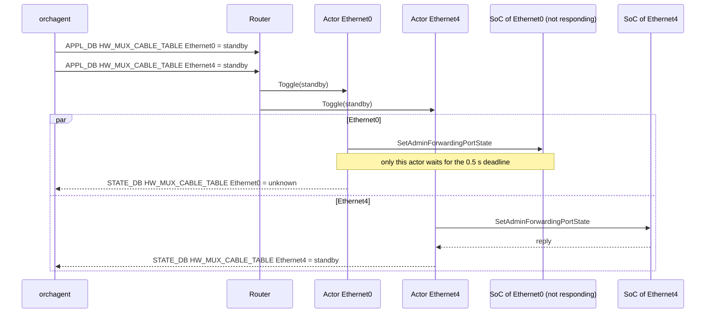

<!-- Part 4 of 5 of doc/dualtor/ycabled_to_rust_hld.md (sonic-net/SONiC#2635), lines 893-1093. Split only because the file exceeds Copilot's per-file review limit; links to sections in other parts do not resolve here. -->

### 4.3 Components

#### 4.3.1 Process, runtime and supervision

- **Binary:** `/usr/bin/ycabled-rs`, started by supervisord as program `ycabled` ([Section 4.6](#46-build-packaging-and-selection)).
- **Runtime:** tokio with 2 worker threads. DB access and gRPC are async; only Python driver calls, which block, run on tokio's blocking threads, started when needed ([Section 4.3.6](#436-y-cable-bridge-embedded-python)).
- **Supervisor task:**
  - SIGTERM or SIGINT: stop accepting events, close the channels and exit 0 within 2 s, without deleting any tables (C7, N9).
  - SIGHUP: ignored, as in Python.
  - A task that ends unexpectedly or panics: log an error and exit 1, and supervisord restarts the daemon (N8).

#### 4.3.2 DB access

- **Library:** the `redis` crate with tokio (D9). One module, `db.rs`, gives it swss-common's semantics, and the rest of the code uses a `Db` trait with an in-memory mock for unit tests:
  - DB IDs, separators, host and port come from `database_config.json`, or `database_global.json` for the namespaces, as swss-common reads them. Like Python's `daemon_base.db_connect`, ycabled-rs connects over TCP.
  - `set` is one multi-field `HSET`, which merges fields as swss-common's `Table::set` does.
  - A subscription is what `SubscriberStateTable` does: `PSUBSCRIBE __keyspace@<db>__:<table><sep>*`, then the rows that already exist (`KEYS` and `HGETALL`), then one `HGETALL` per notification. A `del` notification is a DEL; a notification for a row that is gone again is skipped. A notification carries no value, so a row written several times before its notification is handled is read with its latest value each time, as with `SubscriberStateTable`: requests are states, not events (N2).
  - Waiting for `CONFIG_DB_INITIALIZED` subscribes to its keyspace notification instead of polling.
  - If the subscription connection is lost, ycabled-rs logs an error and exits 1, and supervisord restarts it (N8).
- **Ready-table dispatch:** each keyspace notification names its table and key, so the namespace's subscription task reads that row only and passes the change to the namespace's routing task, which sends it to the port's actor. Both handle the notifications in the order redis delivered them, whatever the table, so a port's requests reach its actor in that order: a toggle written after a cable insertion runs after it. A notification never makes ycabled-rs look at another table.
  - Python can adopt the same improvement independently: register `fd -> (asic_index, original SubscriberStateTable, handler)` and look up the ready object's `getFd()`. Keep the original table for `pop()`, since SWIG returns a `Selectable`, not the original subscriber wrapper. `BmcEventHandler` in [bmcctld](https://github.com/sonic-net/sonic-platform-daemons/blob/master/sonic-bmcctld/scripts/bmcctld) is existing prior art.
  - This removes repeated empty-table checks and duplicated dispatch blocks; it does not by itself remove Python worker threads or Redis connections. In ycabled-rs, one task per namespace serves all of its subscriptions on the shared runtime, without an OS thread per group of tables, and only driver calls block.
- **Namespaces:** connections per namespace, for the same front-end namespaces Python's `multi_asic` uses. Dualtor platforms are single-ASIC today, but the code keeps the namespace dimension.
- **Connections:** 20 subscriptions: 4 toggle and probe tables, 13 CLI command tables plus `XCVRD_DOWN_FW_STATUS_CMD`, `XCVRD_LOG` and `TRANSCEIVER_INFO`. They share one pub/sub connection per namespace. `TRANSCEIVER_INFO` is subscribed to whatever the ports; the other 19 tables only once the namespace has a mux port, at startup or later, through the same connection and task. If redis refuses a subscription, ycabled-rs exits, as for a lost connection. CONFIG_DB, APPL_DB and STATE_DB have one multiplexed connection each, which reconnects by itself. That is 4 connections per namespace, whatever the number of ports (N5).
- **Schema in one place:** table names, field names and value encoders (timestamps, Python `str()` of numbers) live in one module that the tests use too.

#### 4.3.3 Router and port actors

| Message | Source | Handling |
| --- | --- | --- |
| Init | Startup, or `TRANSCEIVER_INFO` SET for a port not yet initialized | Load the driver or create the channel, then write the initial state ([Section 3.2](#32-threads-and-lifecycle)) |
| Remove | `TRANSCEIVER_INFO` DEL | [Section 3.3.7](#337-cable-insertion-and-removal) |
| Toggle(state) | APPL_DB `HW_MUX_CABLE_TABLE` | [Section 3.3.1](#331-active-standby-toggle) or the self case of [Section 3.3.3](#333-active-active-toggle-self-and-peer) |
| PeerToggle(state) | APPL_DB `HW_FORWARDING_STATE_PEER` | Peer case of [Section 3.3.3](#333-active-active-toggle-self-and-peer) |
| MuxProbe | APPL_DB `MUX_CABLE_COMMAND_TABLE` | [Section 3.3.2](#332-active-standby-probe) |
| ForwardingProbe | APPL_DB `FORWARDING_STATE_COMMAND` | [Section 3.3.4](#334-active-active-forwarding-state-probe) |
| Telemetry tick | The port's 60 s timer, in the actor's loop | Starts a pass in a task of its own ([Section 4.3.7](#437-telemetry)) |
| Cli(command) | APPL_DB `XCVRD_*_CMD` | [Section 3.3.9](#339-cli-commands) |

- **Port state:** each actor owns its port's name, physical index, cable type, initialization state, and driver handle or gRPC client. As in Python, the read side is kept in STATE_DB `HW_MUX_CABLE_TABLE`, and active-active ports share their namespace's read side from Loopback3. An actor shares only its call lock, epoch and probe counters with its own telemetry pass, and its channel's connectivity state with the connection monitor, which writes `response=failure` itself ([Section 4.3.4](#434-soc-grpc-client)). No other state is shared between ports.
- **One operation at a time:** insertion and removal, toggles, probes and CLI commands for a port all go through its actor, which finishes each one, including its writes to the port's DB entries, before it starts the next. The cross-thread races of Python ycabled (issues 26 to 29 in [Section 3.7](#37-known-issues)) cannot occur, and `test_concurrency.py` checks it ([Section 6.3](#63-black-box-component-tests)).
- **Telemetry beside the actor:** a pass makes dozens of driver calls, so it runs in a task of its own, and a toggle does not wait for the whole pass:
  - active-standby: the port's call lock, a fair mutex, covers every call to the cable: driver calls, presence checks, and loading and unloading the driver. A request holds it while it runs, and the pass takes it for one call at a time. A toggle waits for at most one call of the pass, no call of the pass comes between the calls of a request, and two calls to one cable never overlap. Python takes its port lock per call.
  - active-active: RPCs share the port's HTTP/2 channel and do not wait for each other, as in Python, whose threads share one stub.
  - A pass that overlaps an initialization, a removal or a change of cable type of its port, while it waits for its turn or while it runs, is not written, because its values may be stale.
- **Mailboxes:** bounded without losing anything. A port keeps at most one pending request per table: a newer notification for the same table replaces the pending one in its place, since both would read the same latest row ([Section 4.3.2](#432-db-access)). A `TRANSCEIVER_INFO` removal followed by an insertion is kept as both, so a swapped cable is removed, then initialized. A port whose driver call never returns therefore holds a few requests, not an ever-growing queue. Routing never waits for a mailbox, so other ports are not affected. Requests for ports that are not in `MUX_CABLE` are dropped, as Python does. CLI commands for such ports get Python's answer for a port without a Y-cable driver, or without a cable if `TRANSCEIVER_INFO` has none.
- **Long-running work:** a firmware download runs in its own task, so toggles for that port are not held up for minutes. Telemetry and the CLI read the driver's `download_firmware_status` and, while it is in progress, report the last known firmware versions, as Python does ([Section 3.3.9](#339-cli-commands)). So the driver must accept other calls while `download_firmware` runs. Python ycabled relies on this too: it calls `download_firmware` without the port lock.
- **Startup:** `TRANSCEIVER_INFO` is subscribed to before the ports initialize, so a cable inserted or removed meanwhile is handled right after its port's initialization. The request subscriptions start once every port is initialized, or after 30 s. Each subscription first delivers the rows that already exist ([Section 4.4](#44-workflows)). A port's requests wait behind its own initialization, so a driver call that never returns holds up only its port.

#### 4.3.4 SoC gRPC client

- **Channel:** one tonic channel per port to `http(s)://<soc_ip>:50075` (`[addr]` for IPv6), connected lazily. HTTP/2 keepalive every 4 s with an 8 s timeout, also while idle, and a 0.5 s deadline on every RPC, as in Python.
- **Requests and replies:** the same requests, and the same reply parsing by read_side, as Python ([Section 3.4.1](#341-soc-grpc-service)).
- **TLS:** from `GRPCCLIENT`: the CA from `ca_crt`, a client identity from `client_crt` and `client_key` for mutual authentication, and the domain name from `grpc_ssl_credential`. Files are read when the channel is created, as in Python, and `/etc/sonic/grpc_secrets.json` is applied to CONFIG_DB at startup.
- **Connectivity:** tonic does not report gRPC connectivity states, but linkmgrd depends on when `response=failure` is written (C2).
  - ycabled-rs wraps the connector (`Endpoint::connect_with_connector`) to see connection attempts, established connections and closed connections. A connection counts as established only once TLS, when configured, and the HTTP/2 handshake have completed, as in grpc-core; one that fails or does not complete them within the RPC deadline counts as failed.
  - From those events a per-port state machine derives `CONNECTING`, `READY`, `TRANSIENT_FAILURE` and `IDLE`. Entering `TRANSIENT_FAILURE` or `IDLE` writes `FORWARDING_STATE_RESPONSE` `response=failure`, and every state is recorded for `grpc_connection_status`.
  - No reconnect timer: a failed or closed connection is set up again by the port's next RPC. grpc-core retries in the background with backoff and, while it waits, fails RPCs at once. ycabled-rs lets each RPC wait for its 0.5 s deadline instead. For a SoC that accepts no HTTP/2 connection, ycabled-rs answers up to 0.5 s later than Python, but only on that port ([Section 5.3](#53-measured-results)).
  - The black-box tests run a SoC double that accepts, drops, refuses and blackholes connections, and check the resulting writes for both implementations.
- **GracefulRestart:** one task per port with a SoC IP, with the same request, re-subscription timing and log-only handling ([Section 3.3.6](#336-gracefulrestart)).

#### 4.3.5 Port map, presence and transceiver info

- **Port map:** physical index from CONFIG_DB `PORT|<name>` `index`; ASIC from the namespace. This is what Python reads too: `SfpUtilHelper` takes CONFIG_DB `PORT` and falls back to `port_config.ini` only when `PORT` is empty. Mux ports are never broken out.
- **active-active (no Python):**
  - present if STATE_DB has `TRANSCEIVER_INFO|<port>` (D3)
  - always present on VS, as in Python
- **active-standby:** the bridge makes the same calls as Python, `chassis.get_sfp(i).get_presence()` and `get_transceiver_info()` with the sfputil fallback, so driver selection does not change.

#### 4.3.6 Y-cable bridge (embedded Python)

- **Interpreter:** PyO3 embeds pmon's CPython (3.13 on trixie). It starts at startup, before the actors, if any port is active-standby; otherwise the first time a port needs it, so an active-active-only device never starts it. If the platform API cannot be loaded, ycabled-rs exits 1, as Python does when it has neither the platform API nor an sfputil plugin. The interpreter is initialized without Python's own signal handlers, so SIGTERM stays with Rust.
- **Bridge module:** a small Python module compiled into the binary owns all Python objects: the chassis and one driver per port. It exposes flat functions:
  - `load(port, physical_index)`: vendor mapping, simulator override and the `get_vendor()` check; `unload(physical_index)` and `has_driver(physical_index)`
  - `call(physical_index, method, args)` and `attr(physical_index, name)`, returning plain values that keep the Python type and `str()`
  - `presence(physical_index)` and `transceiver_info(physical_index)`

  Rust never holds a Python object, so each operation crosses the language boundary once. This is the same principle as the platform API facade ([#768](https://github.com/sonic-net/sonic-platform-common/pull/768)), and the module can move there if sonic-platform-common adds a Y-cable facade.
- **Threads:** each call runs on one of tokio's blocking threads, which are started when needed and stop after 10 s idle, and takes the GIL. Drivers release it during I2C I/O, so different ports can make progress at the same time. Each port makes one call at a time (its call lock, [Section 4.3.3](#433-router-and-port-actors)).
- **Shared-bus limit:** the calls of active-standby telemetry passes run one at a time across the ports, as the calls of Python's serial pass do, to avoid overloading shared I2C buses. A pass never waits for the limit while it holds its port's call lock, or for the lock while it holds the limit. So a port held by a long request delays only its own pass, where Python's pass waits for it, and so do the ports after it; and a call that hangs holds up the other ports' telemetry, not their requests. Toggles, probes and CLI commands are not counted against it.
- **Watchdog:** Python calls cannot be cancelled. A call still running after 5 s is logged at WARNING, and its end at NOTICE. A stuck call blocks its own port and one blocking thread, unless it keeps the GIL ([Section 4.8](#48-restrictions-and-limitations)). A port has at most two calls in flight, one from its actor and one from its telemetry pass, besides firmware downloads, and up to 512 threads can run, so stuck calls on some ports never leave the others without a thread. In Python, one stuck call stops every port served by the same thread.
- **Driver logger:** the logger passed to the drivers forwards to the Rust logger (D7).

#### 4.3.7 Telemetry

- **Timing:** each actor gets its own 60 s timer, and its first pass is 60 s after the actor starts, as Python's first pass is 60 s after startup. A tick that comes while the port's previous pass still runs is skipped.
- **Writes:** each pass reads its own port's cable or SoC and writes that port's `MUX_CABLE_INFO` row, in one `HSET`; no task collects the values of several ports. The actor keeps handling the port's requests meanwhile, and a pass that overlapped an initialization, a removal or a change of cable type is dropped ([Section 4.3.3](#433-router-and-port-actors)).
- **Contents:** the same tables and fields as Python ([Section 3.5.4](#354-mux_cable_info-and-mux_cable_static_info)).
- **Disable:** stopped while `disable_telemetry` is `True`.
- **Concurrency:** each pass runs in its own task ([Section 4.3.3](#433-router-and-port-actors)). Active-active passes run for all ports in parallel, at most 16 at a time. The calls of active-standby passes take the bridge's shared-bus limit. A pass delays the port's requests only on active-standby: a toggle, probe or CLI command waits for the one telemetry call in progress on its cable, never for the rest of the pass or for other ports' telemetry. Active-active requests share the port's channel with the pass and do not wait for it.

#### 4.3.8 CLI commands

- **Routing:** one subscription per `XCVRD_*_CMD` table, and the command goes to the port's actor.
- **Order of writes:** the actor writes the result rows, then the response field, then deletes the command key, in the same order as Python. Field names and values are the same ([Section 3.5.5](#355-cli-command-tables)); a driver's return value is answered as Python's `str()` of it.
- **Where Python crashes:** a port outside the port map, an argument that is not an integer, or a rollback without a driver kill Python's CLI thread. ycabled-rs answers these commands as errors and logs a warning.
- **Not started without mux ports:** while the namespace has no mux port, the command subscriptions are not started, so the CLI times out as it does with Python. They start once it has one, at startup or later; Python starts its CLI thread only if a cable was initialized at startup (issue 16).

#### 4.3.9 Logging

- **Identity:** syslog identity `ycable`, without the PID (Python does not set `LOG_PID`), facility USER, default minimum level NOTICE, as with `sonic_py_common`'s Logger.
- **Level control:** `XCVRD_LOG|Y_CABLE.log_verbosity` switches between debug and notice.
- **Text:**
  - Messages matched by sonic-mgmt keep their exact text: `URLError ... No route to host` (from the simulated driver) and `Error: Could not get port instance for muxcable info for Y cable port Ethernet`. The third rule, `executing the cli for prbs thread`, matches nothing Python ycabled still logs.
  - Other messages keep their wording where practical.
  - Nothing is logged at ERR that Python logs at a lower level (C5).

### 4.4 Workflows

**Startup:**

1. Connect to the default namespace's databases and wait for `CONFIG_DB_INITIALIZED`. Read `DEVICE_METADATA` to detect VS, and find the namespaces.
2. Write `XCVRD_LOG|Y_CABLE` `log_verbosity=notice`, as Python does. Build the port map, and per namespace determine read_side from Loopback3 (looked up again when an active-active cable is initialized while it is still unknown, as Python does), apply `grpc_secrets.json` to CONFIG_DB and read the `MUX_CABLE` ports.
3. Start the Y-cable bridge if any port is active-standby.
4. Create an actor for every `MUX_CABLE` port and subscribe to `TRANSCEIVER_INFO`, then initialize all actors in parallel. A cable inserted or removed meanwhile is handled right after its port's initialization. Startup waits until every port is initialized, for at most 30 s.
5. Start the subscriptions of the request tables if the namespace has mux ports. Each first delivers the rows that already exist, so requests written during startup are handled then, as in Python.
6. Start the GracefulRestart tasks if any port is active-active, with the read side known then: like Python, look Loopback3 up again if it is still unknown.

**Toggles of two ports, one SoC not responding.** Compare with the serial case in [Section 3.3.3](#333-active-active-toggle-self-and-peer):



**Shutdown:** on SIGTERM, ycabled-rs stops the subscriptions, cancels the actors and the GracefulRestart streams, closes the channels and exits 0. Tables are not deleted (C7).

### 4.5 Deliberate behavior differences

| Area | Python | Rust | Reason |
| --- | --- | --- | --- |
| Concurrency | Every port in one thread, one request at a time | One actor per port | N1 |
| Startup | Ports initialized one by one; threads start after the last port | Ports initialized in parallel; the request subscriptions start after the last port, as in Python, or after 30 s | N3; a hung driver call holds up only its port |
| Cable removed during startup | Missed: `TRANSCEIVER_INFO` is subscribed to after initialization, and its first rows do not include the removed cable | Handled after the port's initialization | `TRANSCEIVER_INFO` is subscribed to before initialization |
| Order across tables | Within one select wake-up, a fixed table order; cable insertion and removal in another thread | The order redis delivered the notifications, for all of a namespace's tables | A toggle written after a cable insertion runs after it ([Section 4.3.2](#432-db-access)) |
| Shutdown | Never ends by itself; tables kept | Exits within 2 s; tables kept | N9, C7 |
| Thread or task failure | Process killed within 60 s | Process exits at once | N8 |
| Telemetry | Every 60 s after the previous pass over all ports ends; a port busy with a request holds up the ports after it | Every 60 s per port; a port busy with a request holds up only its own pass | Independent of port count, SoC health and the other ports' requests |
| Presence of active-active cables | Platform API | STATE_DB `TRANSCEIVER_INFO` | D3 |
| Redis connections | 125 with 24 active-standby ports, 199 with 32 active-active ports ([Section 5.3](#53-measured-results)) | 4 per namespace | N5, D9 |
| RPCs to a SoC that accepts no HTTP/2 connection | Fail at once between grpc-core's connection attempts | Wait for the 0.5 s deadline | No reconnect timer ([Section 4.3.4](#434-soc-grpc-client)); affects only that port |
| `response=failure` when a channel is created | Written, because a new channel reports `IDLE` | Not written | No connection has failed yet; the first failed connection writes it |
| Slow driver calls | Not logged | Logged after 5 s | [Section 4.3.6](#436-y-cable-bridge-embedded-python) |
| Firmware activation | The CLI thread waits 5 s after `activate_firmware`; the port's toggles go on | The port's actor waits 5 s, toggles of that port included | The cable restarts its firmware meanwhile; other ports are not affected |
| CLI commands where Python crashes | The CLI thread dies, and the process exits within 60 s | Answered as errors | [Section 4.3.8](#438-cli-commands) |
| Syslog identity | Changes with import order | Always `ycable` | C5 |
| Issues in [Section 3.7](#37-known-issues) | | Same behavior as Python after the fix | Fixed in Python first, unless reviewers decide otherwise |

### 4.6 Build, packaging and selection

- **Source:** `sonic-ycabled-rs` in sonic-platform-daemons (D1). Dependencies: tokio, redis (D9), tonic and prost with rustls, and PyO3. No swss-common and no C++ library.
- **Build:** in sonic-slave-trixie (Rust 1.98.1, protoc 3.21). PyO3 links the libpython of pmon's base image (Python 3.13). Until the package rules exist, `sonic-ycabled-rs/build.sh` builds and runs the unit tests in an image based on docker-sonic-vs (Debian 12, Python 3.11), the image the black-box suite runs in.
- **Package:** `sonic-ycabled-rs`, which contains `/usr/bin/ycabled-rs` (the bridge module is compiled in). It is built by `rules/sonic-pmon-daemons-rs.mk` from [#29860](https://github.com/sonic-net/sonic-buildimage/pull/29860) and installed in pmon next to the Python wheel.
- **Selection** (`docker-pmon.supervisord.conf.j2`, inside its `DualToR` condition); everything else in the entry stays as it is:

```jinja

[program:ycabled]


command=bash -c "sleep 30 && nice -n -20 {{ ycabled }}"

command=nice -n -20 {{ ycabled }}

```

- **Which file:** at every start, pmon renders its supervisord configuration from the HwSKU's `pmon_daemon_control.json` if there is one, otherwise from the platform's. The two are not merged, so a HwSKU file repeats the keys of the platform file. In sonic-buildimage, some platforms share a file through a symlink: 46 Arista platforms, the 7050CX3 dual ToRs among them, link to `x86_64-arista_common`. A platform or HwSKU that turns ycabled-rs on alone needs a file of its own. The image copies the files with the links resolved.
- **On a DUT:** add `"use_rust_ycabled": true` to `/usr/share/sonic/device/<platform>/pmon_daemon_control.json`, or to `<platform>/<hwsku>/pmon_daemon_control.json` if that exists, and run `sudo systemctl restart pmon`. To go back, remove the key and restart pmon. The change survives reboots but not an image upgrade.

### 4.7 Warm reboot, fast reboot and restart

- **No warm-restart state:** neither implementation keeps any. At startup, ycabled-rs reads the cable and SoC state again, as Python does.
- **Shorter refresh window:** parallel initialization shortens the time during which `HW_MUX_CABLE_TABLE` is stale after a restart.
- **Tables survive:** they are kept across restarts (C7), so linkmgrd and orchagent keep seeing the last known state while ycabled restarts.

### 4.8 Restrictions and limitations

- The vendor drivers stay Python, so devices with active-standby ports keep an embedded interpreter and save less memory.
- Connectivity states are derived from connection events ([Section 4.3.4](#434-soc-grpc-client)). There is no reconnect timer, so a `failure` is written when a connection fails or is lost, not again on every background attempt as grpc-core may.
- A Python driver call cannot be cancelled. A hung call blocks only its own port and one blocking thread, unless it keeps the GIL: then every active-standby port stops, as it does in Python.
- Active-standby ports need the platform API (`sonic_platform`). The legacy `sfputil` plugin, which Python ycabled falls back to, is not supported.
- ycabled-rs must be built for the Python version of pmon's base image.
